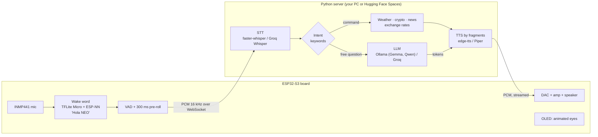
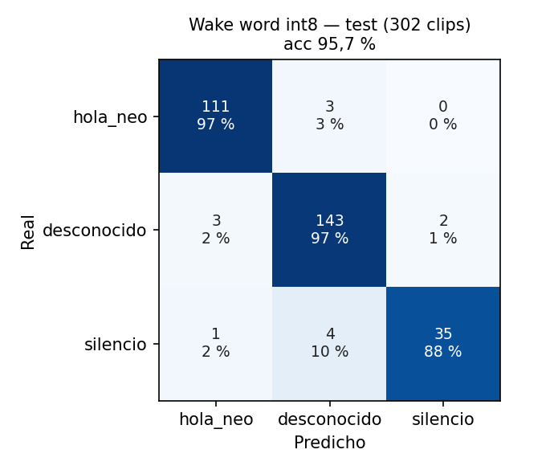
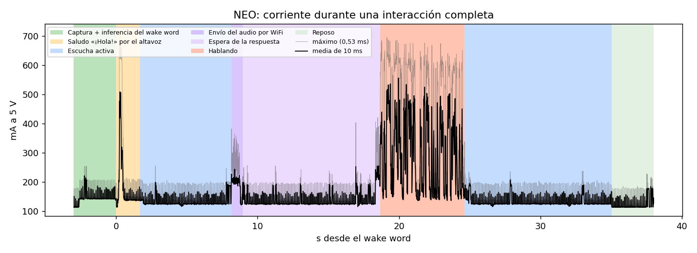

# NEO — open-source ESP32-S3 voice assistant with an offline wake word and a local LLM

[](https://github.com/techmiguel/neo-robot/actions/workflows/ci.yml)
[](LICENSE)


**NEO** is a DIY smart speaker built around an **ESP32-S3**. You say **"Hola NEO"**: a
15 KB **TinyML** model (TensorFlow Lite Micro, int8) recognizes the **wake word on the
chip, offline**. Then you ask anything, hands-free. A Python server on your PC transcribes
the question with **Whisper**, answers it with a **local LLM (Ollama: Gemma, Qwen)** or the
cloud (Groq), and talks back through the speaker with **streaming text-to-speech**.

It is a privacy-friendly, hackable **Alexa / Google Home alternative** you can build on a
breadboard for the price of a few modules, and **every number in this README was measured
on the real board**, with the raw data in the repo.



## Highlights

- **Offline wake word on a microcontroller.** A CNN on MFCC features, quantized to int8
  and accelerated with Espressif's ESP-NN SIMD kernels: **0.32–0.40 s per inference**,
  **~1.1 s** from the end of "Hola NEO" to NEO answering. Test accuracy 95.7 %; the full
  training pipeline is included.
- **Local-first.** The board talks to your PC on the LAN; if it is not there, it falls
  back to a cloud deployment. The server can run **fully local** (faster-whisper + Ollama)
  or on free cloud tiers (Groq + edge-tts).
- **Streaming responses.** The LLM's tokens are cut into phrases, each one is synthesized
  and sent as soon as it is ready, and the firmware starts playing after 256 ms of buffered
  audio, without waiting for the full reply.
- **Commands without an LLM.** Weather, crypto prices, tech news and Cuban informal
  exchange rates are answered by keyword intent detection and real APIs: faster, cheaper
  and no hallucinations.
- **Robust on bad networks.** Prerecorded phrases tell you when WiFi, the server or the
  internet is down. WiFi sleeps after 10 min idle and the CPU drops to 80 MHz while the
  wake word keeps listening.
- **Measured, not claimed.** Word error rate, latency per pipeline stage, wake word
  confusion matrix and power draw per state, from 31-phrase sessions read to the board.

## Quick start

You need the [hardware](#hardware), a PC on the same network (Windows, macOS or Linux) and
about 30 minutes.

### 1. Server

```bash
git clone https://github.com/techmiguel/neo-robot.git
cd neo-robot/servidor
python -m venv .venv
.venv\Scripts\activate          # Windows; on macOS/Linux: source .venv/bin/activate
pip install -e ".[dev]"
cp .env.example .env            # Windows: copy .env.example .env
```

Pick a profile and edit `.env`:

| Profile | What runs where | You need |
|---|---|---|
| `nube` (cloud, easiest) | Groq Whisper + Groq LLM + edge-tts | A free [Groq API key](https://console.groq.com/keys) in `GROQ_API_KEY` |
| `local` | faster-whisper + Ollama on your PC, edge-tts voice (Piper offline fallback) | `pip install -e ".[local]"`, [Ollama](https://ollama.com) with `ollama pull gemma4:e2b` (or `qwen2.5:3b`) |

The command APIs are optional: `OPENWEATHER_API_KEY`, `NEWSAPI_KEY` and `ELTOQUE_API_KEY`
(free tiers; CoinGecko needs no key). Every variable is explained in
[`servidor/.env.example`](servidor/.env.example).

```bash
python -m src.server.ws_server --perfil nube     # or --perfil local
```

The server listens on `ws://0.0.0.0:8765`. Note your PC's LAN IP address.

### 2. Firmware

Install [PlatformIO](https://platformio.org/install) (VS Code extension or `pip install platformio`).

```bash
cd neo-robot/firmware
cp src/config_local.example.h src/config_local.h   # Windows: copy; set NEO_SERVIDOR_HOST to your PC's IP
pio run -e esp32dev --target upload
pio device monitor -e esp32dev
```

The first build downloads the ESP32 toolchain and TensorFlow Lite Micro and takes a few
minutes. Without `config_local.h` the firmware builds with a placeholder IP (`192.168.1.100`)
and no cloud fallback.

### 3. First boot

1. NEO has no WiFi yet, so it opens an access point called **`NEO-Config`**. Join it from
   your phone and open <http://192.168.4.1>.
2. Enter your WiFi name and password. NEO saves them, connects, and finds the server.
3. Say **"Hola NEO"**, wait for the greeting and ask, in Spanish: *"¿Cuál es la capital de
   Japón?"*, *"¿Va a llover mañana en La Habana?"*, *"¿Cuánto vale el bitcoin?"*.

No wake word? Press the **BOOT** button briefly to ask without it. The model was trained on
two voices; if it does not wake for yours, [train it on your voice](#train-the-wake-word-on-your-voice).

### Troubleshooting

| Symptom | Fix |
|---|---|
| `Could not install package 'links2004/WebSockets'` on Windows | The path is too long for Windows (260 characters). Clone to a short path such as `C:\neo`. |
| `This chip is ESP8266, not ESP32-S3` while flashing | Another board is on the default port. Pass it explicitly: `--upload-port COM8` (the Freenove shows up as *USB-Enhanced-SERIAL CH343* in `pio device list`). |
| Serial log full of `ASSOC_TOOMANY` | Your access point (often a phone hotspot) has no free client slots. Disconnect a device. |
| `time: missing unit in duration "-1"` from Ollama | Use `OLLAMA_KEEP_ALIVE=-1m`, with a unit. |
| NEO hears the wake word but misses the start of your question | Wait for the greeting to finish. The VAD calibrates the background noise for 0.5 s after it. |
| The first answer takes minutes with the local profile | Ollama is loading the model from disk; later answers are fast. Keep it loaded with `OLLAMA_KEEP_ALIVE=-1m`. |

## Hardware

| Part | Notes |
|---|---|
| Freenove ESP32-S3 WROOM CAM (FNK0085), N8R8 module | 8 MB flash, 8 MB PSRAM |
| INMP441 I2S microphone | I2S_NUM_0 |
| PCM5100A + PAM8403 I2S DAC/amplifier module, 8 Ω speaker | I2S_NUM_1 |
| SSD1306 128 × 64 I2C OLED | Animated eyes and connection status |

Wiring, pin tables and the mistakes to avoid are in **[docs/hardware.md](docs/hardware.md)**.
A compact custom PCB (**NEO Lite**, 31 × 43 mm, USB-C, ready for JLCPCB assembly) is in
[`hardware/neo-lite/`](hardware/neo-lite/), designed in KiCad 9 but not yet fabricated.

## What you can ask

NEO speaks **Spanish**. After the wake word it detects the intent of the transcription:

| Intent (keywords) | Answer | Source |
|---|---|---|
| clima, "qué tiempo hace", temperatura, pronóstico | Current weather (default city: La Habana) | OpenWeatherMap |
| dólar, euro, tasa, El Toque | Informal Cuban peso (CUP) exchange rates | El Toque API |
| bitcoin, ethereum, cripto | Crypto price | CoinGecko |
| noticias, titulares | Tech news (Apple, Google, Nvidia, OpenAI…), one headline per outlet | NewsAPI |
| hola, "qué tal" | Greeting | — |
| anything else | Free answer in NEO's voice: a stranded alien traveller, curious, with dry humour, ≤ 20 words | LLM |

Adding a command is a Python class on the server (`servidor/src/commands/`); the firmware
does not change.

## Measured results

All numbers come from the board. Method, raw data and analysis are linked.

**Wake word "Hola NEO"**, CNN int8 on the ESP32-S3, two speakers
([experiments](firmware/models/experimentos/2026-10-20/RESUMEN.md), [metrics](docs/metrics/wake_word_20261020/))

| Metric | Value |
|---|---|
| Test accuracy (int8, 302 clips) | 95.7 % |
| True / false positive rate per window (threshold 0.7618) | 95.6 % / 0.6 % |
| Inference time with ESP-NN kernels | 0.32–0.40 s (2.6 s with the reference kernels) |
| End of "Hola NEO" → confirmed, on the board | **1.1 s** median (1.11 s on 24/10, n = 4; 1.09 s on 25/10, n = 5) |



**Conversation**, 31 phrases read to the board, same audio sent to every server variant.
Word error rate ignores accents. Latency runs from the end of the recording to the first
audio of the reply, median (p90).

| Session | STT + LLM + TTS | WER | Intent | Free questions | Commands |
|---|---|---|---|---|---|
| 24/10 ([analysis](docs/metrics/validacion_20261024/ANALISIS.md)) | Cloud: Groq Whisper + gpt-oss-20b + edge-tts | 3.1 % | 96.8 % | 5.7 s (8.0 s) | 5.1 s (6.1 s) |
| 24/10 | Local: Whisper small + qwen2.5:3b + edge-tts | 6.2 % | 96.8 % | 8.8 s (9.6 s) | 6.2 s (9.5 s) |
| 25/10 ([analysis](docs/metrics/validacion_gemma4_streaming/ANALISIS.md)) | Local: Whisper small + gemma4:e2b, streaming | **5.1 %** | **100 %** | 18.0 s with the long prompt* | — |

\* The 25/10 run exposed that gemma4:e2b re-processes the system prompt on every question
(~37 tokens/s on a laptop i5): the 409-token prompt cost ~8 s. The local profile now uses
a 139-token prompt (2.7–3.3 s in Ollama, not yet re-measured end to end). Streaming saves
~1.9 s once answers are long enough to split; edge-tts costs ~1.9 s per call from Cuba.
On the board, add 1.5 s of end-of-speech silence and ~0.6 s of WiFi upload.

**Power at 5 V** (INA219, [method](docs/experimento-consumo.md), [data](docs/metrics/consumo_20261024_preliminar/), preliminary)

| State | Mean current | Peak | Mean power |
|---|---|---|---|
| Rest, listening for the wake word | 119 mA | 249 mA | 0.60 W |
| Wake word capture + inference | 137 mA | 255 mA | 0.69 W |
| Sending audio over WiFi | 153 mA | 408 mA | 0.76 W |
| Speaking | 302 mA | 797 mA | 1.44 W |



## Train the wake word on your voice

The model ships in the firmware (`firmware/src/models/`) and was trained on two speakers.
The recordings are not published (they are people's voices), but the pipeline is:

```bash
cd firmware
pio run -e dataset_capture --target upload               # firmware that streams clips over serial
pip install -r tools/requirements_dataset.txt
python tools/capture_dataset.py --port COM8              # guided recording per class
pip install -r tools/requirements_train.txt
python tools/train_model.py                              # trains, quantizes to int8, exports TFLite
python tools/gen_vocabulario.py --umbrales models/umbrales.json
python tools/tflite_to_header.py                         # writes src/models/*.h
pio run -e esp32dev --target upload
```

`tools/vocabulario.json` (classes, phrases, thresholds) is the single source of truth for
capture, training and inference. The experiments behind the current model (cross-validation,
leave-one-speaker-out, negative speech) are in
[`firmware/models/experimentos/`](firmware/models/experimentos/).

## Other firmware environments

| `pio run -e …` | Purpose |
|---|---|
| `esp32dev` | Full firmware: wake word, WebSocket, audio, OLED |
| `hw_test` | Checks OLED, microphone, speaker and button |
| `loopback_test` | Plays the microphone through the speaker |
| `wake_word_test` | Wake word inference without the server |
| `dataset_capture` | Records training clips over serial |
| `demo_ojos` / `demo_bocina` | Eyes animation / speaker playback demos |
| `consumo_logger` | Power logger on an ESP8266 + INA219 |

## Benchmark your own setup

The server includes the validation panel used for every number above: it relays the board's
audio to several server variants (models, providers, streaming on/off), scores the
transcriptions against the corpus and reads the latency from the board's serial log.

```bash
cd servidor
python -m src.benchmark.panel --variante "gemma=local,OLLAMA_MODEL=gemma4:e2b" --variante "nube=nube"
```

Open <http://localhost:8080>, read the phrase it shows to NEO, and press *Generar informe*
at the end. Details in [`servidor/benchmark/README.md`](servidor/benchmark/README.md).

## Repository layout

```
firmware/            ESP32-S3 firmware (C++, PlatformIO + Arduino)
  src/               audio, display, network, commands (TFLite inference), main.cpp
  tools/             dataset capture, training, header generation, log analysis
  models/            trained models and the experiments behind them
  logs/              serial logs of the measured sessions
servidor/            Python server: STT, intent, LLM, TTS, WebSocket, benchmark panel
hardware/neo-lite/   custom PCB: KiCad project, generator scripts, Gerbers, BOM
docs/                design notes, experiments and measured metrics (in Spanish)
ROADMAP.md           phases and status (in Spanish)
```

## Documentation

The design notes and experiment reports are written in Spanish.

| Topic | Document |
|---|---|
| Wiring and parts | [docs/hardware.md](docs/hardware.md) |
| Software strategy: voice, prerecorded phrases, network on demand | [docs/estrategia-software.md](docs/estrategia-software.md) |
| Streaming responses and where the latency goes | [docs/streaming-latencia.md](docs/streaming-latencia.md) |
| Conversation memory | [docs/diseno-memoria.md](docs/diseno-memoria.md) |
| Experiments: latency, wake word latency, false positives, full flow, power | [`docs/experimento-*.md`](docs/) |
| Measured sessions | [docs/metrics/](docs/metrics/) |
| Custom PCB, phase by phase | [hardware/neo-lite/README.md](hardware/neo-lite/README.md) |
| Status and next steps | [ROADMAP.md](ROADMAP.md) |

## Design decisions

- **Only the wake word runs on the chip.** A multi-command local classifier would need a
  dataset per phrase and a reflash per change. Commands live on the server and grow without
  touching the firmware; the cost is that every question needs the network.
- **Keywords before the LLM.** Common commands skip the LLM: faster, free and
  deterministic. The LLM only gets free-form questions.
- **Two I2S buses.** Microphone and DAC each get their own peripheral; no time multiplexing.
- **Inference buffers in internal SRAM.** PSRAM access with WiFi active tripped the watchdog.
- **One voice.** NEO always speaks with edge-tts `es-CU-ManuelNeural`, including its
  prerecorded phrases; Piper only answers when edge-tts is unreachable.

## Failure modes

Every message below is prerecorded in the firmware, so NEO can say it without a server.

| Situation | What NEO does |
|---|---|
| Server unreachable (LAN and cloud) | Says "No encuentro mi servidor", and "Ya estoy conectado y listo" when it is back |
| WiFi down | Says it cannot connect; the wake word keeps working |
| No internet on the server | The server sends `sin_internet`; NEO says "No puedo acceder a internet ahora" |
| Empty transcription | "No te entendí, ¿me lo repites?" and listens again |
| Server silent for 30 s | "Está tardando demasiado, inténtalo otra vez" |
| edge-tts unreachable | The server answers with Piper (different voice) |
| LLM drifts into another script (qwen2.5:3b → Chinese) | The server asks again once, then strips non-Latin text |
| Wake word false positive | NEO greets, hears nothing for 10 s and goes back to rest |

## Security and limitations

- The WebSocket has **no authentication**; it assumes a trusted LAN. Add a token or TLS
  before exposing the server. API keys live in `servidor/.env` (gitignored).
- **Spanish only**: STT, prompts and voice.
- **Short memory**: the last 5 exchanges per WebSocket session, in RAM.
- **USB power**: speaking peaks at ~0.8 A at 5 V; a single boosted 18650 cell browns out.
- **No OTA updates** yet; flash over USB.
- The local profile is slower and less accurate than the cloud one on a laptop CPU.

## Contributing

Issues and pull requests are welcome; see [CONTRIBUTING.md](CONTRIBUTING.md). Run the tests
before sending changes:

```bash
cd servidor && pytest
cd firmware/tools && pytest
```

## License and acknowledgements

[MIT](LICENSE). Built on [TensorFlow Lite Micro](https://github.com/espressif/esp-tflite-micro),
[ESP-NN](https://github.com/espressif/esp-nn), [faster-whisper](https://github.com/SYSTRAN/faster-whisper),
[Ollama](https://ollama.com), [Groq](https://groq.com), [edge-tts](https://github.com/rany2/edge-tts),
[Piper](https://github.com/rhasspy/piper), [Adafruit SSD1306](https://github.com/adafruit/Adafruit_SSD1306)
and [arduinoWebSockets](https://github.com/Links2004/arduinoWebSockets).

*¿Hablas español?* Lee el [README en español](README.es.md).
