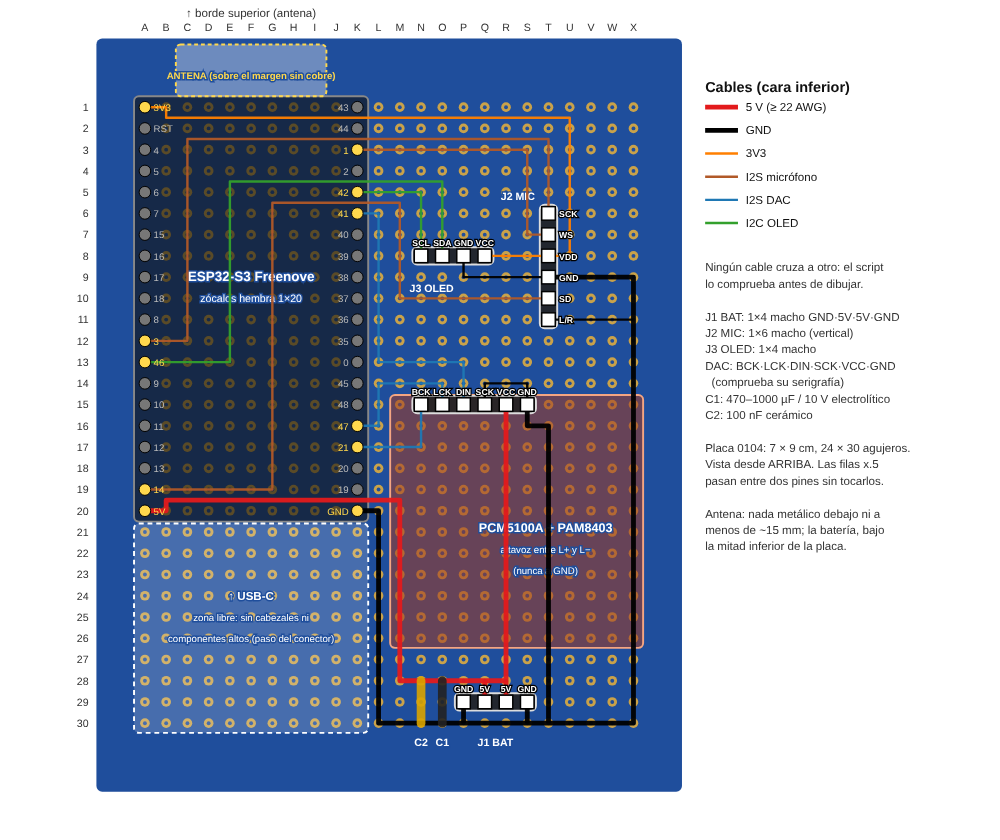

# Montaje de NEO en placa perforada

Montaje fijo de NEO para la prueba completa y el vídeo: el mismo cableado de
[hardware.md](hardware.md), pasado de la protoboard a una placa perforada de doble cara
dentro de un chasis de PVC. No cambia ningún pin, así que el firmware (`esp32dev`) sirve
tal cual.

En la placa solo van la Freenove y el módulo DAC + amplificador. El micrófono y la OLED
se colocan en el chasis donde mejor funcionen y llegan a la placa por cable, a cabezales
macho. La batería va debajo con su protección, su cargador y su elevador pegados a ella;
a la placa solo llegan 5 V y GND, también a un cabezal macho.

El plano es una vista desde arriba (lado de los componentes); las líneas de colores son
los cables que van por la cara inferior, y las filas «x,5» (por ejemplo 19,5) pasan entre
dos pines sin tocarlos. Lo genera `hardware/placa-perforada/gen_plano.py` (SVG en
`img/montaje_placa_perforada.svg`).

**Ningún cable cruza a otro.** Todo el cableado va por la cara inferior en una sola capa:
antes de dibujar, el script comprueba que dos redes distintas no se tocan y que ningún
cable pasa por un pad ajeno (incluidos los pines libres de la Freenove), y falla si
ocurre. Para conseguirlo:

- Las cuatro señales de la tira izquierda (3V3, GPIO 3, 46 y 14) pasan bajo la Freenove
  en forma de «L» anidadas, en las columnas B, C, E y G, y cruzan la tira derecha por
  encima de las de esa tira. El 5V cruza entre GPIO 19 y GND (fila 19,5).
- El orden de los pines de J2 y J3 está elegido para que cada cable llegue a su pin sin
  rodear a otro. Cablea los módulos según ese orden (ver «Cabezales»).
- La OLED queda «dentro» de los cables del micrófono: WS y SCK pasan por encima de J3 y
  SD por debajo. El 3V3 rodea J2 por fuera y entra a VDD por la derecha; de ahí sale a la
  OLED. La masa del micrófono y de la OLED sube por el borde derecho (columna X).

## Placa

**7 × 9 cm, 24 × 30 agujeros** (0104 en el catálogo de Lumex). Es la única de las
disponibles en la que cabe la Freenove (57,2 × 28,0 mm) con el módulo DAC al lado.

## La antena

La antena del ESP32-S3-WROOM-1 es la franja de 18 mm × 6 mm del extremo superior del
módulo, el del pin 1 (3V3 / GPIO 43). Según el
[pinout oficial de Freenove](https://github.com/Freenove/Freenove_ESP32_S3_WROOM_Board),
esa franja **sobresale de la PCB de la Freenove**: va de 1,3 mm a 7,5 mm por encima de la
fila del pin 1. Freenove la diseñó así para que no tenga cobre debajo, y la placa
perforada no debe estropearlo.

Por eso la Freenove va con **el pin 1 en la fila 1**. En una placa de 90 mm con 30 filas
centradas, el margen entre la fila 1 y el borde es de unos 8,2 mm: la antena queda
entera sobre ese margen, que es laminado sin cobre, y su extremo a ~0,7 mm del borde.
Debajo no hay agujeros, pads ni cables. Los cables más cercanos son el de 3V3 y el de
GPIO 3, en las filas 1,5 y 2,5: van bajo el blindaje del módulo, a unos 2,5 mm de la
proyección de la antena y ~10 mm por debajo de ella.

Compruébalo antes de soldar: pon la Freenove en su sitio (con los zócalos) y mira que la
franja de la antena no tape ningún agujero de la placa. Si tu placa tiene un margen
menor y la antena pisa la fila de agujeros del borde, no pasa nada grave, pero no sueldes
nada en esos agujeros.

Para el chasis:

- Nada metálico a menos de ~15 mm de la antena: ni tornillos (usa de nailon en la esquina
  superior izquierda), ni la batería, ni el altavoz, ni cinta de aluminio.
- La batería y sus módulos, debajo de la **mitad inferior** de la placa (la del USB y el
  conector J1), no debajo de la antena.
- El PVC no bloquea el WiFi; la antena puede ir pegada a una pared del chasis, mejor si
  esa pared mira hacia el router.

## Distribución

| Zona | Posición | Motivo |
|---|---|---|
| Freenove | Columnas A y K, filas 1–20 (pin 1 arriba) | Antena sobre el margen sin cobre de la placa. |
| Paso del USB-C | Columnas A–K, filas 21–30 | El conector queda dentro de la placa; ahí no van cabezales ni nada alto para que entre el cable. |
| J3, cabezal de la OLED | N8–Q8 (horizontal) | Lejos de la antena y del amplificador. |
| J2, cabezal del micrófono | T6–T11 (vertical) | Lejos del amplificador; sus cables no pasan por la zona del DAC. |
| Módulo DAC + amplificador | Pines en N15–S15, cuerpo hacia abajo | Junto a GPIO 41/47/21 y a la entrada de 5 V. |
| J1, cabezal de la batería, C1 y C2 | Filas 28–30, abajo a la derecha | Junto al amplificador, que hace los picos de ~0,8 A, y en el extremo opuesto a la antena. |

## Cabezales

Los tres son tiras macho de 2,54 mm. Al conectar cada módulo, guíate por su serigrafía,
no por la posición en el dibujo.

| Cabezal | Pines, de izquierda a derecha | Cable hasta |
|---|---|---|
| J1 batería (P29–S29) | GND · 5V · 5V · GND | Salida de 5 V del elevador/regulador de la batería |
| J2 micrófono (T6–T11, de arriba abajo) | SCK · WS · VDD · GND · SD · L/R | INMP441 |
| J3 OLED (N8–Q8) | SCL · SDA · GND · VCC | SSD1306 |

El orden de J2 y J3 no es el de la serigrafía de los módulos: es el que deja el cableado
de la placa sin cruces. El cable Dupont hace la conversión; márcalo (cinta o rotulador)
para no invertirlo al montar el chasis.

**J1 es simétrico** (GND, 5V, 5V, GND): si el conector hembra de 4 vías entra al revés,
la polaridad sigue siendo correcta. Usa los cuatro pines: cada contacto Dupont tiene
decenas de mΩ, y con dos en paralelo por línea la caída en los picos de ~0,8 A es la
mitad. Los dos GND y los dos 5V están puenteados por debajo.

En J2, el pin **L/R ya está unido a GND en la placa**: el cable lo lleva al L/R del
INMP441 y así el micrófono sale por el canal izquierdo, como espera el firmware.

## Módulo DAC

El plano supone que los pines del módulo están en el orden de la tabla de
[hardware.md](hardware.md): **BCK · LCK · DIN · SCK · VCC · GND**, con el cuerpo del
módulo hacia abajo (hacia J1). No lo he podido comprobar en el módulo real. Si su
serigrafía tiene otro orden, el trazado del DAC cambia (el del micrófono y la OLED no):
antes de soldar esa zona, compara la serigrafía con el plano y, si no coincide, ajusta el
orden en `CABEZALES` de `gen_plano.py`; la comprobación dirá si el nuevo trazado cruza.

## Conexiones

| Señal | Pin de la Freenove | Recorrido (cara inferior) | Destino | Cable |
|---|---|---|---|---|
| 3V3 | 3V3 (A1) | B1 → B1,5 → U1,5 → U8 → T8 | VDD del micro (T8); de T8 a VCC de la OLED (Q8) | fino |
| Micro SCK | GPIO 3 (A12) | C12 → C2,5 → T2,5 | SCK (T6) | fino |
| Micro WS | GPIO 1 (K3) | S3 → S7 | WS (T7) | fino |
| Micro SD | GPIO 14 (A19) | G19 → G5,5 → M5,5 → M10 | SD (T10), por debajo de J3 | fino |
| OLED SDA | GPIO 46 (A13) | E13 → E4,5 → O4,5 | SDA (O8) | fino |
| OLED SCL | GPIO 42 (K5) | N5 | SCL (N8) | fino |
| DAC DIN | GPIO 41 (K6) | L6 → L13 → P13 | DIN (P15) | fino |
| DAC LCK | GPIO 47 (K16) | L16 → L14 → O14 | LCK (O15) | fino |
| DAC BCK | GPIO 21 (K17) | N17 | BCK (N15) | fino |
| DAC SCK | — | Q14 → S14 | GND del DAC (S15): activa el PLL interno del PCM5100A | fino |
| 5 V | 5V (A20) | B20 → B19,5 → M19,5 → M28 → bus de la fila 28 → R28 → R15 | C2 (N28), C1 + (O28), J1 (Q29, R29), VCC del DAC (R15) | ≥ 22 AWG |
| GND | GND (K20) | L20 → L30 → bus de la fila 30 → X30 | C2 (N30), C1 − (O30), J1 (P29, S29) | ≥ 22 AWG |
| GND del DAC | — | T30 → T16 → S16 | GND del DAC (S15) | ≥ 22 AWG |
| GND del micro y la OLED | — | X30 → X9 → T9; X11 → T11 | GND (T9) y L/R (T11) del micro; T9 → P9 → GND de la OLED (P8) | fino |

El altavoz va a los bornes del módulo, entre **L+ y L−**: la salida del PAM8403 es en
puente y ningún cable del altavoz puede tocar GND.

## Cables al chasis

- **Micrófono:** cable plano o trenzado de 6 hilos, **20 cm como máximo**, que no vaya
  junto a los cables del altavoz. El reloj del I2S es de ~1 MHz y un cable corto va bien.
  Si sale ruido o clics, el primer remedio es una resistencia de 33 Ω en serie con SCK,
  junto a A12.
- **OLED:** hasta ~30 cm sin problema; las resistencias de *pull-up* del I2C ya están en
  el módulo.
- **Batería:** cable de ≥ 22 AWG y lo más corto posible. Los cables largos hasta la
  batería tienen inductancia, y C1 es el que da la corriente de los picos mientras el
  elevador reacciona.

## Por qué así

- **Masa por caminos separados.** Los picos del amplificador vuelven por S15 → T16 → T30
  y llegan a J1 por el bus de la fila 30 sin pasar por el pin GND de la Freenove. La masa
  del micrófono y de la OLED sale de X30, al otro lado de J1, así que tampoco la recorre la
  corriente del amplificador. El ruido del clase D (que ya apareció en el I2C y en el log,
  ver `ROADMAP.md` 1.4) no se suma a la referencia de los periféricos de señal.
- **C1 y C2 se quedan en la placa** aunque la electrónica de la batería esté fuera. Los
  picos de corriente tienen que salir de un condensador junto a la carga, no del otro
  extremo de un cable.
- **5 V por fuera de la Freenove.** El amplificador toma los 5 V directamente del bus de
  J1, y la Freenove los recibe por su pin 5V con un cable aparte.

## Material

| Pieza | Cantidad |
|---|---|
| Placa perforada doble cara 7 × 9 cm (0104) | 1 |
| Tira de pines hembra 1 × 20 (zócalos de la Freenove) | 2 |
| Tira de pines hembra para el módulo DAC (según su conector) | 1 |
| Tira de pines macho: 1 × 4 (J1), 1 × 6 (J2), 1 × 4 (J3) | 14 pines |
| Cables Dupont hembra-hembra o con carcasa de 4 y 6 vías | — |
| Condensador electrolítico 470–1000 µF, ≥ 10 V (C1) | 1 |
| Condensador cerámico 100 nF (C2) | 1 |
| Cable rígido fino (26–30 AWG) para señales y 22 AWG para 5 V/GND | — |
| Tubo termorretráctil (0162) para los cables del altavoz y de la batería | — |

## Orden de montaje y pruebas

1. Suelda los zócalos de la Freenove (pin 1 en la fila 1) y comprueba que la antena no
   tapa agujeros. Después, los cabezales, el zócalo del DAC y los condensadores.
2. Haz los cables de potencia (5 V y GND, gruesos).
3. **Sin la Freenove ni el DAC puestos**, mide con el polímetro: sin continuidad entre
   5 V y GND ni entre 3V3 y GND. Conecta la batería a J1 y mide 5 V en A20 y en R15.
4. Haz los cables de señal, empezando por los que pasan bajo la Freenove (columnas G, E,
   C y B, de dentro afuera), y revisa cada uno con continuidad contra la tabla de arriba.
5. Inserta la Freenove sola y flashea `esp32dev` por USB (sin batería). Después añade los
   módulos de uno en uno: OLED (ojos), micrófono (wake word), DAC y altavoz (frase de
   arranque).
6. Para el vídeo, con la batería en J1 y sin USB: arranque, «Hola NEO», respuesta.

## Avisos

- **USB y batería a la vez.** No sé si la Freenove tiene un diodo entre el VBUS del USB
  y su pin 5V. Hasta comprobarlo, no conectes el USB con la batería en J1: podrías meter
  la salida del elevador en el puerto del PC, o el USB en la salida del elevador. Para
  flashear o ver el log, quita el conector de J1. Si el polímetro marca un diodo (caída
  de 0,2–0,4 V) entre VBUS y 5V, no hay problema.
- **La batería tiene que dar ≥ 1 A a 5 V.** Con el MT3608 y una sola 18650 el ESP32-S3 se
  reinicia por *brownout* aunque el montaje esté bien (`ROADMAP.md` 1.3).
- **GPIO 46 es un pin de arranque.** Las resistencias de *pull-up* de la OLED lo ponen en
  alto; en protoboard ha funcionado así, pero si un día la placa no entra en modo de
  descarga al flashear, desconecta J3 y vuelve a probar.
