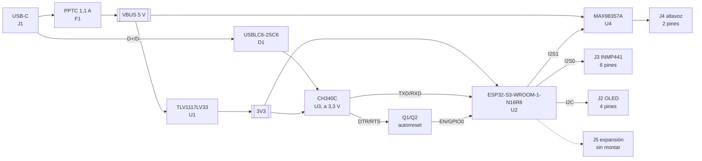

# NEO Lite — Fase 1: selección de componentes, BOM y coste

Documento de trabajo de la fase 1. Fija las piezas, el mapa de pines y los cálculos de los que
parten el esquemático (fase 2) y el PCB (fase 3), y estima el coste del primer pedido.

> **Revisión B (placa compacta, 12-10-2026).** El módulo pasa a ESP32-S3-WROOM-1U-N16R8 con
> antena externa, el CH340C y el autorreset se sustituyen por el USB nativo del S3 y se elimina J5.
> Las secciones 2.1, 2.2, 3 y 4 describen la revisión A; los cambios y el coste vigente están en
> § 6.

## 0. Alcance y método

NEO Lite es una placa nueva de 2 capas, de diseño propio, que lleva a una PCB la plataforma con la
que hoy funciona el firmware: ESP32-S3, micrófono INMP441, amplificador I2S y OLED SSD1306. Quedan
fuera el XMOS, la batería y su gestión, los LED y el puerto Grove de NEO v2.

Las hojas de datos se descargaron y se leyeron. Las citas de sección o tabla corresponden a estas
versiones:

| Pieza | Documento leído |
|---|---|
| ESP32-S3-WROOM-1 | Espressif, *ESP32-S3-WROOM-1 & WROOM-1U Datasheet* (tabla 3-1, tabla 6-2) |
| ESP32-S3 | Espressif, *ESP32-S3 Hardware Design Guidelines* (§ alimentación, CHIP_PU, pines de arranque, tabla 7) |
| MAX98357A | Maxim/ADI, *MAX98357A/MAX98357B* (características eléctricas, tablas 5–6, "Power-Supply Input", "Layout and Grounding") |
| CH340C | WCH, *CH340 Datasheet* (§ 4, tabla de pines; § 5, alimentación a 3,3 V) |
| TLV1117LV33 | TI, *TLV1117LV* (§ 6.5, § 8.2.2.1, tabla de datos térmicos) |
| AMS1117-3.3 | AMS, *AMS1117* (características eléctricas, nota de estabilidad); solo para comparar |
| USBLC6-2SC6 | ST, vía LCSC |
| HRO TYPE-C-31-M-12 | Plano de HRO, vía LCSC |

El stock, el precio y la categoría (básica, preferida o extendida) son una instantánea de la API
de JLCPCB del 12-10-2026 (`docs/data/jlc_cache.json`), y cambian a diario. Las tarifas de montaje
son las de la página de precios de PCBA de JLCPCB, actualizada el 09-09-2026. Todo se reproduce
con:

```
python3 tools/jlc_search.py <palabra o código> ...   # consulta candidatos
python3 tools/bom_fase1.py [--offline]              # BOM, docs/data/bom_fase1.csv y coste
```

## 1. Arquitectura



## 2. Decisiones por bloque

### 2.1 Módulo: ESP32-S3-WROOM-1-N16R8 (C2913202)

Lleva el chip ESP32-S3R8 con PSRAM octal de 8 MB a 3,3 V y flash quad de 16 MB. Coincide con
`board_build.arduino.memory_type = qio_opi` del `platformio.ini` actual, así que el firmware no
cambia. GPIO35–37 los ocupa la PSRAM (tabla 3-1, nota b). GPIO47/48 trabajan a 3,3 V en esta
variante; solo la R16V los pone a 1,8 V (nota c).

Un detalle a tener en cuenta: las variantes con PSRAM octal de este módulo están especificadas
hasta 65 °C de ambiente (tabla de variantes). Es suficiente para un asistente de sobremesa, pero
impide meterlo en una caja cerrada junto a una fuente caliente.

Espressif pide que la alimentación externa entregue al menos 0,5 A (tabla 6-2). También recomienda
una red RC en EN de 10 kΩ y 1 µF, al menos 10 µF en la entrada de alimentación y protección ESD en
esa entrada.

### 2.2 USB y puente serie: CH340C (C84681)

El CH340C integra el reloj, así que no necesita cristal. En SOP-16 tiene DTR# (pin 13) y RTS#
(pin 14), las dos señales que exige el autorreset clásico de dos transistores. El CH340N, en
SOP-8, no tiene DTR# y por eso no sirve. El CH340K (ESSOP-10) sí serviría, pero lleva pad
expuesto y es más difícil de reparar a mano.

Se alimenta a 3,3 V con VCC y V3 unidos (hoja, § 5: "When using 3.3V power supply, V3 should
connect with VCC"). Así TXD y RTS/DTR salen con niveles de 3,3 V y nunca inyectan 5 V en el
ESP32. UD+ y UD− van directos al conector, sin resistencias en serie, como pide la hoja.

Con este puente se conserva `ARDUINO_USB_CDC_ON_BOOT=0` y el flujo actual (`Serial` por UART0 y
autorreset). GPIO19/20, el USB nativo, quedan libres. Llevo cada uno a un punto de prueba como
vía de depuración por USB-Serial-JTAG si un día hiciera falta. No cuesta piezas.

### 2.3 Regulador: TLV1117LV33 (C15578) y no AMS1117

El AMS1117-3.3 es pieza básica: no paga la tarifa de 3,07 USD por extendida y cuesta 0,21 USD.
Lo descarto por dos datos de su hoja:

1. **Caída.** Es de 1,1 V típica y 1,3 V máxima a 0,8 A. Con 0,4 A de pico en 3V3 y la caída del
   PPTC, exige VBUS ≥ 3,3 + 1,1 + 0,2 ≈ 4,6 V. Un puerto USB 2.0 puede entregar 4,4 V en el
   dispositivo, con cable largo o concentrador, y el ESP32 quedaría por debajo de los 3,0 V
   mínimos durante un pico de TX.
2. **Estabilidad.** La hoja solo la garantiza con 22 µF de tántalo ("The addition of 22µF solid
   tantalum on the output will ensure stability for all operating conditions"). Con cerámicos de
   ESR baja hay riesgo de oscilación, y JLCPCB monta cerámicos como pieza básica.

El TLV1117LV33 cae 230 mV a 500 mA (§ 6.5), es estable con cerámicos desde 1 µF y con ESR nula
(§ 8.2.2.1), y sigue en SOT-223 (RθJA 62,9 °C/W). Su entrada máxima recomendada es de 5,5 V
(absoluta 6 V), dentro de la tolerancia del USB. El sobrecoste es de unos 3,6 USD en el pedido
(tarifa más diferencia de precio).

| Margen de alimentación (3V3, pico de 0,385 A) | Valor |
|---|---|
| Consumo de pico en 3V3 | 355 mA del módulo en TX (descripción LCSC; 340 mA de la hoja del S3) + 20 mA de la OLED + 7 mA del CH340C + 1,4 mA del INMP441 + 1,4 mA de pull-ups ≈ **0,385 A** |
| Caída del PPTC a 0,77 A (3V3 + amplificador a 4 Ω) | 0,77 A × 0,25 Ω (máx.) ≈ 0,19 V |
| VBUS mínimo con TLV1117LV | 3,3 + 0,30 (margen sobre los ~0,19 V a 0,4 A) + 0,19 ≈ **3,8 V**; el USB da ≥ 4,4 V |
| VBUS mínimo con AMS1117 | 3,3 + 1,1 + 0,19 ≈ **4,6 V**: sin margen |
| Disipación en U1 | Pico (5,0 − 3,3) × 0,385 = 0,65 W → +41 °C; media en Wi-Fi activo (~0,12 A) ≈ 0,2 W → +13 °C |

### 2.4 Audio de salida: MAX98357A (C910544)

Elección propia, como pediste. Es DAC I2S y amplificador clase D sin filtro en un solo chip
TQFN-16 de 3 × 3 mm, y sustituye al par PCM5100A + PAM8403. Comprobé que el firmware actual
funciona sin cambios en la parte I2S:

| Requisito de la hoja | Firmware actual (`speaker.cpp`) | ¿Cumple? |
|---|---|---|
| LRCLK de 8, 16, 32, 44,1, 48, 88,2 o 96 kHz | 16 kHz | Sí |
| BCLK de 32, 48 o 64 × LRCLK, entre 0,2432 y 25,8 MHz | 32 bits × 2 canales → 64 × 16 kHz = 1,024 MHz | Sí |
| Datos de 16, 24 o 32 bits, I2S estándar (variante A) | 32 bits, `I2S_CHANNEL_FMT_RIGHT_LEFT` | Sí |
| VIH de entradas digitales ≥ 1,3 V | Niveles de 3,3 V | Sí |
| Sin MCLK | El firmware no lo genera | Sí |

El firmware escribe la misma muestra en los dos canales, así que cualquier modo de canal del
amplificador reproduce lo mismo.

**SD_MODE.** Va a GPIO40 y, por R6 de 470 kΩ, a 3V3. Con el pin interno de 100 kΩ (92–108 kΩ), el
divisor deja SD_MODE entre 0,54 y 0,63 V cuando GPIO40 está en alta impedancia. Eso cae en la
ventana del modo (L + R)/2, entre B0 máx. de 0,355 V y B1 mín. de 0,65 V (tabla de umbrales), así
que el amplificador suena aunque el firmware no toque el pin. GPIO40 a nivel bajo apaga el chip
(0,6 µA). GPIO40 a nivel alto selecciona el canal izquierdo. El margen superior, 0,63 V frente a
0,65 V, es estrecho en el peor caso de tolerancias. No es crítico, porque el firmware debe llevar
el pin activamente a nivel alto o bajo (fase 6). Lo dejo documentado. 470 kΩ es pieza preferida;
los 560 kΩ que centrarían la ventana son extendidos y costarían 3,07 USD de tarifa.

**Ganancia.** GAIN_SLOT va a VDD por R7 (0 Ω) para fijar 6 dB. R8 a GND queda sin montar para
pasar a 12 dB. A fondo de escala, 2,1 dBV + 6 dB = 2,54 Vrms: 0,81 W en 8 Ω y 1,6 W en 4 Ω. Elijo
6 dB y no los 9 dB por defecto para limitar el pico en VBUS (§ 2.6). El volumen se ajusta además
por firmware.

**Desacoplo.** 10 µF y 100 nF junto a VDD (§ "Power-Supply Input"). El pad expuesto va a GND.
Las salidas son pistas anchas y paralelas hacia J4 (§ "Layout and Grounding"). La hoja pide un
altavoz con más de 10 µH de inductancia serie; los de 8 Ω típicos tienen entre 20 y 100 µH.

**Alternativa NS4168 (C910588).** Hoy cuesta 0,74 USD frente a 1,32 USD a 5 unidades: ahorraría
unos 3 USD en el pedido, también es extendida y tiene una hoja de datos mucho más pobre. No
compensa.

### 2.5 Protección de entrada

| Pieza | Función | Comentario |
|---|---|---|
| R1, R2 5,1 kΩ en CC1/CC2 | Que un cargador USB-C entregue 5 V | Sin ellas, un cargador C-a-C no da tensión |
| F1 BSMD1206-110-6V (C2803344) | Corte ante cortocircuito en VBUS | 1,1 A de mantenimiento y 2,2 A de disparo. Los conectores se sueldan a mano y un corto en J4 o J5 es plausible |
| D1 USBLC6-2SC6 de ST (C7519) | ESD en D+/D− y VBUS | Lo recomienda Espressif en la entrada de alimentación. El equivalente de Tech Public (C2827654) cuesta 0,05 USD frente a 0,18 USD; prefiero el original por unos 0,65 USD en el pedido |

La capacidad total en VBUS (10 µF de C1, 10 µF de C2 y 10 µF de C9) supera los 10 µF que la
especificación USB 2.0 permite en la conexión. Es habitual en placas de desarrollo, sin efecto
práctico con el PPTC en serie, y no se busca certificación USB-IF.

### 2.6 Presupuesto de corriente en VBUS

| Caso | 3V3 | Amplificador | Total en VBUS |
|---|---|---|---|
| Reposo (Wi-Fi conectado, OLED encendida) | ~0,12 A | 2,4 mA | ~0,13 A |
| Pico, altavoz de 8 Ω a fondo de escala | 0,385 A | 0,81 W / 0,9 / 5 V ≈ 0,18 A | ~0,57 A |
| Pico, altavoz de 4 Ω a fondo de escala | 0,385 A | 1,6 W / 0,85 / 5 V ≈ 0,38 A | ~0,77 A |

El caso de 4 Ω supera los 500 mA de un puerto USB 2.0 estricto. Con un cargador de 5 V/1 A o un
puerto USB 3 no hay problema. La voz tiene un factor de cresta alto, así que la media real queda
muy por debajo. Recomiendo un altavoz de 8 Ω.

### 2.7 Conectores (soldados a mano)

No hay restricción mecánica, así que todos los periféricos van por cable dupont con tiras macho
de 2,54 mm. Es lo más barato y deja colocar el micrófono lejos del altavoz dentro de la caja, lo
que también ayuda a la detección de la wake word.

| Ref. | Tira | Orden de pines (pin 1 primero) |
|---|---|---|
| J2 | 1 × 4 | GND, VCC (3V3), SCL, SDA: el orden habitual de los módulos SSD1306 de 0,96" |
| J3 | 1 × 6 | GND, VDD (3V3), SD, SCK, WS, L/R (unido a GND en la placa → canal izquierdo, como hoy) |
| J4 | 1 × 2 | OUTP, OUTN |
| J5 | 2 × 10, sin montar | 16 GPIO libres (4–13, 15–18, 38, 39) + 5V + 3V3 + 2 × GND; GPIO48 va a un punto de prueba (TP8) |

Los módulos INMP441 de distintos fabricantes ordenan sus pines de forma diferente. Con cable, el
orden de la placa no depende del módulo. Si prefieres enchufarlo directamente, necesito la
disposición y la separación de los pines de tu módulo (ver § 5).

## 3. Mapa de pines definitivo

| Señal | GPIO (pin del módulo) | Notas |
|---|---|---|
| MIC WS / SCK / SD (I2S0) | 1 (39) / 3 (15) / 14 (22) | Como hoy. GPIO3 es pin de arranque solo para la fuente de JTAG, y únicamente si el eFuse STRAP_JTAG_SEL está quemado; aquí es salida del ESP32 |
| SPK BCLK / LRCK / DIN (I2S1) | 21 (23) / 47 (24) / 41 (34) | Como hoy |
| AMP SD_MODE | 40 (33) | Nuevo |
| OLED SDA / SCL | 2 (38) / 42 (35) | **Cambio**: con GPIO0 = 0, GPIO46 debe ser 0 para la descarga (guía de diseño, tabla 7). Los pull-ups de la OLED en GPIO46 la impedirían. En la fase 3 pasa de GPIO8/9 a GPIO2/42, junto a J2 (ver `fase3-colocacion.md` § 3) |
| BOOT / pulsador de usuario | 0 (27) | Como hoy (`trigger.h`) |
| UART0 TX / RX | 43 (37) / 44 (36) | Hacia RXD/TXD del CH340C |
| EN | 3 | RC 10 kΩ / 1 µF, RESET y autorreset |
| USB nativo D− / D+ | 19 (13) / 20 (14) | Solo puntos de prueba (TP2/TP1) |
| Sin uso | 45, 46 | Pines de arranque: sin carga externa |

## 4. BOM y coste

18 grupos y 30 piezas SMD por placa, todas en la cara superior. Detalle en
`docs/data/bom_fase1.csv`.

| Ref. | Pieza | LCSC | Tipo | Stock | USD/ud. |
|---|---|---|---|---|---|
| U2 | ESP32-S3-WROOM-1-N16R8 | C2913202 | extendida | 34 320 | 5,15 |
| U4 | MAX98357AETE+T | C910544 | extendida | 32 307 | 1,32 |
| U3 | CH340C | C84681 | extendida | 135 516 | 0,61 |
| U1 | TLV1117LV33DCYR (TI) | C15578 | extendida | 5 741 | 0,39 |
| J1 | TYPE-C-31-M-12 | C165948 | extendida | 407 280 | 0,19 |
| D1 | USBLC6-2SC6 (ST) | C7519 | extendida | 47 826 | 0,18 |
| F1 | BSMD1206-110-6V | C2803344 | extendida | 24 139 | 0,05 |
| R6 | 470 kΩ 0402 | C25790 | preferida | 233 222 | 0,003 |
| Resto (11 grupos) | Pasivos 0402/0805, MMBT3904, pulsadores | — | básicas | > 300 000 | — |

| Concepto (5 placas, PCBA económico, una cara) | USD |
|---|---|
| PCB de 2 capas, ≤ 100 × 100 mm, 5 uds. (estimación: el precio promocional va de 2 a 4 USD) | 4,00 |
| Puesta en marcha (8,18) y plantilla (1,53) | 9,71 |
| 7 piezas extendidas × 3,07 | 21,49 |
| 790 juntas × 0,0016 | 1,26 |
| Piezas | 43,13 |
| **Total sin envío ni impuestos** | **79,59 (15,92 por placa)** |

El módulo ESP32 es el 32 % del total, y las tarifas de extendidas, el 27 %. Para comparar con
NEO v2: aquel diseño tenía 88 grupos extendidos, 367 piezas por placa, 4 capas y montaje por las
dos caras.

Supuestos no verificados:

1. **Piezas preferidas sin tarifa.** La página de precios no dice si las piezas "preferidas"
   están exentas de la tarifa de extendida. En el peor caso, R6 añadiría 3,07 USD.
2. **Desperdicio y mínimos de compra.** JLCPCB puede cargar piezas de más o mínimos de compra en
   algunos grupos. Lo estimo en menos de 2 USD.
3. **Envío e impuestos.** No están incluidos: dependen del país y del método de envío.

### Recortes posibles (no aplicados)

| Cambio | Ahorro aprox. | Coste técnico |
|---|---|---|
| F1 → 0 Ω (básica) | 3,3 USD | Sin protección ante un corto en los conectores soldados a mano |
| U1 → AMS1117 (básica) | 3,6 USD | Ver § 2.3: sin margen de caída y estabilidad dudosa con cerámicos |
| D1 → sin ESD | 4,0 USD | Contra la recomendación de Espressif. Es la menos dañina de las tres si hace falta recortar |
| U4 → NS4168 | ~3 USD | Hoja de datos pobre; no lo recomiendo |

Mi recomendación es no aplicar ninguno: los tres primeros juntos ahorran ~11 USD (14 %) a cambio
de riesgos reales en la primera iteración.

## 5. Decisiones del usuario tras la fase 1 (12-10-2026)

1. Micrófono por cable con la tira 1 × 6 (J3): permite separar el micrófono del altavoz.
2. Altavoz de 8 Ω: pico en VBUS de ~0,57 A (§ 2.6).
3. Sin recortes: se mantiene la BOM base (~80 USD).

## 6. Revisión B: placa compacta

Petición del usuario tras la fase 3: el mismo ESP32-S3 en menos espacio, sin la tira de
expansión J5, y la placa lo más pequeña posible.

### 6.1 Módulo

| Opción | Tamaño | Capacidades | Stock JLCPCB | Valoración |
|---|---|---|---|---|
| **ESP32-S3-WROOM-1U-N16R8 (C3013946)** | 18 × 19,2 mm | Idénticas: el mismo ESP32-S3R8, flash de 16 MB y PSRAM octal de 8 MB, con el mismo patillaje (hoja de datos, cap. 3) | 11 588 | **Elegida.** Sin diseño de RF, sin zona de exclusión de antena. Necesita una antena externa por U.FL/MHF I |
| ESP32-S3-PICO-1-N8R8 | 7 × 7 mm (SiP) | 8 MB de flash, 8 MB de PSRAM | 0 | Descartada: sin stock |
| ESP32-S3R8 + W25Q128 + cristal + antena | El más pequeño | Idénticas | 3826 (chip) | Descartada en esta iteración: red de adaptación y antena en 2 capas sin instrumentos para sintonizarlas |
| ESP32-S3-MINI-1-N4R2 | 15,4 × 20,5 mm | 4 MB de flash, 2 MB de PSRAM quad | 1076 | Descartada: no son las mismas capacidades |

El WROOM-1 de la revisión A obligaba a dejar la antena en el borde con una franja sin cobre de 6
mm a todo lo ancho (zona de exclusión de la huella, de 48 mm). El 1U ahorra 6,3 mm de módulo y esa
franja. El firmware no cambia: mismo chip y mismos GPIO.

**Antena.** Cualquier antena de 2,4 GHz con conector U.FL (IPEX/MHF I) de 50 Ω; por ejemplo, una
adhesiva de FPC con cable de 50–100 mm, pegada dentro de la caja lejos del altavoz y de metal. No
va en la BOM de JLCPCB: se compra aparte (~1 USD).

### 6.2 USB nativo en lugar del CH340C

La descarga y la consola pasan al USB-Serial-JTAG integrado del ESP32-S3 (GPIO19 = D−,
GPIO20 = D+). Salen U3, Q1, Q2, R4/R5 de 10 kΩ, C8 y los puntos de prueba de la UART. Entran R4/R5
de 22 Ω (C25092, básica) en serie con D+/D− junto al módulo, como recomienda la guía de diseño de
Espressif ("reserve series resistors (initial value can be 22/33 Ω)"). Los condensadores a GND
que la guía deja opcionales no se montan, para ahorrar espacio.

Consecuencias para el firmware: `ARDUINO_USB_CDC_ON_BOOT=1`, y `Serial` sale por el USB. esptool
reinicia en modo descarga por el propio USB, sin pulsar BOOT. Si un firmware deja el USB
inutilizable, BOOT + RESET fuerzan la descarga. UART0 (GPIO43/44) queda libre.

### 6.3 Otros cambios

| Cambio | Motivo |
|---|---|
| J5 y TP8 eliminados | Petición del usuario. Los GPIO libres quedan sin conectar |
| 4 taladros M3 → 2 taladros M2 | Un M3 ocupa 7 mm de diámetro; en una placa de 31 × 43 mm, dos M2 (5 mm) en esquinas opuestas bastan para fijarla |
| Puntos de prueba: +5V, +3V3, GND | Los de USB nativo y UART ya no aplican |

### 6.4 BOM y coste (revisión B)

17 grupos y 26 piezas SMD por placa, todas en la cara superior; 6 extendidas (antes 7).

| Concepto (5 placas, PCBA económico, una cara) | Rev. A | **Rev. B** |
|---|---|---|
| PCB de 2 capas (estimación) | 4,00 | 4,00 |
| Puesta en marcha y plantilla | 9,71 | 9,71 |
| Piezas extendidas × 3,07 | 21,49 (7) | 18,42 (6) |
| Juntas × 0,0016 | 1,26 | 1,07 |
| Piezas | 43,13 | 39,13 |
| **Total sin envío ni impuestos** | **79,59** | **72,33 (14,47 por placa)** |

Más 5 antenas U.FL (~5 USD), fuera del pedido de JLCPCB.
