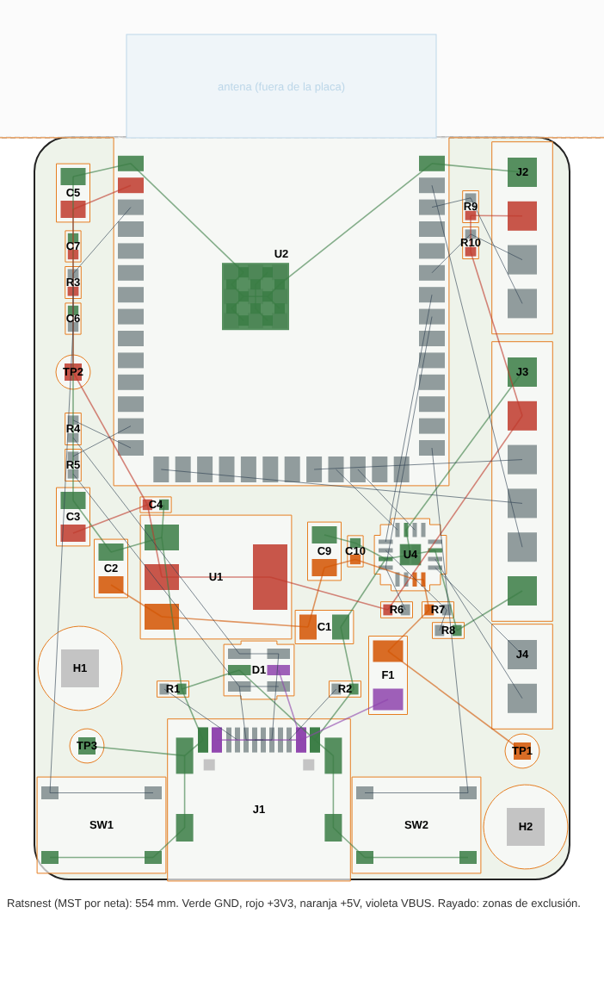

# NEO Lite — Fase 3: colocación y plan de ruteo (revisión B, placa compacta)

Placa de **31 × 43 mm**, 2 capas y 1,6 mm de grosor, con todos los componentes SMD en la cara
superior. Esta fase coloca las piezas y fija contorno, reglas y clases de neta. El ruteo es la
fase 4.

La revisión A medía 56 × 72 mm (WROOM-1 con la antena sobre la placa y su franja sin cobre, CH340C
y tira de expansión J5). La B, con la antena del mismo módulo fuera del borde, USB nativo y sin J5
(`fase1-componentes.md` § 6), ocupa 1333 mm² frente a 4032 mm²: **un 67 % menos**.

| Resultado | Valor |
|---|---|
| Contorno | 31 × 43 mm, esquinas de 1 mm de radio |
| Huellas | 35, todas desde las bibliotecas de KiCad 9.0.9, enlazadas a sus símbolos |
| DRC de colocación | **0 errores**: sin solapes de patio ni piezas fuera de la placa. 93 conexiones sin rutear (esperado); avisos de serigrafía (se limpian en la fase 5); `lib_footprint_mismatch` en U2 (vías térmicas agrandadas a propósito, § 4) |
| Ratsnest (árbol mínimo por neta) | 553 mm (revisión A: 1479 mm) |
| Imágenes | `docs/img/fase3_colocacion.png` (2D con ratsnest), `docs/img/fase3_render_top.png` (render de KiCad, sin modelos 3D) |

Regeneración:

```
python3 tools/gen_schematic.py && python3 tools/verify_schematic.py
python3 tools/build_pcb.py        # kicad/NEO_Lite.kicad_pcb desde la netlist, con la colocación de PLACE
python3 tools/plot_placement.py   # vista 2D con ratsnest
kicad-cli pcb drc --severity-all kicad/NEO_Lite.kicad_pcb
```

## 1. Disposición



| Zona | Contenido | Criterio |
|---|---|---|
| Arriba a la izquierda | U2 (WROOM-1); el borde superior de la placa coincide con el límite cuerpo/antena y la antena (6,3 mm) sobresale | Posición recomendada por Espressif. La zona de exclusión de la huella queda entera fuera de la placa; el DRC no da violaciones |
| Columna izquierda (4 mm) | C5/C7 frente al pin 3V3, R3/C6 frente a EN, TP2 (+3V3), R4/R5 (22 Ω) frente a USB D−/D+ (pines 13/14), C3 | Desacoplo y red RC a menos de 3 mm de sus pines; las resistencias de USB "cerca del chip", como pide Espressif |
| Columna derecha (5 mm) | J2 (OLED) con R9/R10, J3 (micrófono), J4 (altavoz), TP1 (+5V) | Frente a los pines del lateral derecho del módulo: I2C (GPIO2/42), MIC_WS (GPIO1), DIN (GPIO41) y SD_MODE (GPIO40) |
| Franja central | U1 (TLV1117LV33) con C2/C4; U4 (MAX98357A) con C9/C10 y R6–R8; D1, R1/R2, F1, C1 | U4 bajo los pines de I2S del módulo (GPIO21/47) y junto a J4; U1 entre la entrada y la columna de +3V3 |
| Borde inferior | J1 (USB-C) centrado, SW1 (RESET) y SW2 (BOOT) a los lados, H2 (M2) | Conector y pulsadores accesibles desde el mismo borde |
| Lateral izquierdo, abajo | H1 (M2), TP3 (GND) | Taladros en esquinas opuestas |

## 2. Reglas y clases de neta

Sin cambios respecto a la revisión A. Reglas de JLCPCB en 2 capas con margen: pista mínima de
0,15 mm, separación de 0,15 mm, vía de 0,6/0,3 mm (sin suplemento), 0,3 mm del cobre al borde.

| Clase | Netas | Pista | Separación | Vía |
|---|---|---|---|---|
| Default | Señales | 0,25 mm | 0,2 mm | 0,6/0,3 mm |
| Power | VBUS, +5V, +3V3, GND | 0,6 mm | 0,2 mm | 0,8/0,4 mm |
| Speaker | SPK_P, SPK_N | 0,6 mm | 0,2 mm | 0,8/0,4 mm |
| USB | USB_DP, USB_DN | 0,3 mm | 0,2 mm | 0,6/0,3 mm |

R4/R5 dividen D+/D− en dos netas cada una (`USB_DP` → `ESP_DP`). En la fase 4, el tramo entre R4/R5
y el módulo se rutea con la misma anchura que la clase USB.

## 3. Mapa de pines

Igual que en la revisión A (fase 1 § 3, con la OLED en GPIO2/42), salvo:

| Señal | GPIO | Cambio |
|---|---|---|
| USB D− / D+ | 19 / 20 | Ahora es el USB principal (antes, solo puntos de prueba) |
| UART0 TX / RX | 43 / 44 | Sin conectar: la consola va por el USB nativo |
| GPIO libres (4–13, 15–18, 38, 39, 48) | — | Sin conectar (antes, en J5 y TP8) |

## 4. Ajuste de la huella del módulo

Igual que en la revisión A: vías térmicas de 0,2 mm en el pad central. `build_pcb.py` las pasa a 0,3/0,6 mm para evitar el suplemento de JLCPCB. El DRC lo marca
como `lib_footprint_mismatch`, que es lo esperado.

## 5. Plan de ruteo (fase 4)

1. **GND** en la cara inferior, lo más entero posible, y relleno de GND en la superior cosido con
   vías, sobre todo alrededor de U4 y del pad central del módulo.
2. **Potencia.** VBUS: J1 → D1 y F1 → +5V. +5V a C1, a U1 (pin 3, abajo a la izquierda) y a U4
   (pines 7/8). +3V3 desde la lengüeta de U1 hasta C3/C5/C7 y el pin 2 del módulo por la columna
   izquierda; ramas a R3, R6, R9/R10, J2 y J3. Pistas de 0,6 mm.
3. **USB.** D+/D− desde J1 por D1 hasta R4/R5 y los pines 13/14, juntas. Es el tramo que más cruza
   (de abajo al centro a la izquierda), así que tiene prioridad sobre el resto de señales.
4. **Audio.** BCLK, LRCK y DIN cortos hasta U4. OUTP/OUTN de U4 a J4, anchas y juntas.
5. **Control y periféricos.** EN de R3/C6 a SW1 bajando por la izquierda. GPIO0 de pin 27 a SW2.
   I2C y micrófono hacia la columna derecha; MIC_SCK (GPIO3, esquina inferior izquierda del módulo)
   y MIC_SD cruzan por debajo del módulo en la cara inferior.

Riesgo a vigilar: la densidad de la franja central. Con 2 capas y separaciones de 0,2 mm debería
caber, y si no, hay margen para alargar la placa 2–3 mm por abajo.

## 6. Notas mecánicas

1. La antena del módulo sobresale 6,3 mm por el borde superior. Dentro de la caja necesita espacio
   libre alrededor (Espressif recomienda 15 mm, sin metal ni el altavoz), y la placa no debe
   apoyarse ni sujetarse por ese borde.
2. En el plan de ruteo: abundante cobre de GND y vías de cosido a lo largo del borde superior,
   junto a la antena, como pide Espressif.
3. Las tiras macho de J2–J4 (cable dupont) quedan en el borde derecho. Las tiras acodadas en 90°
   (misma huella, montaje a mano) reducen la altura si la caja lo pide.
