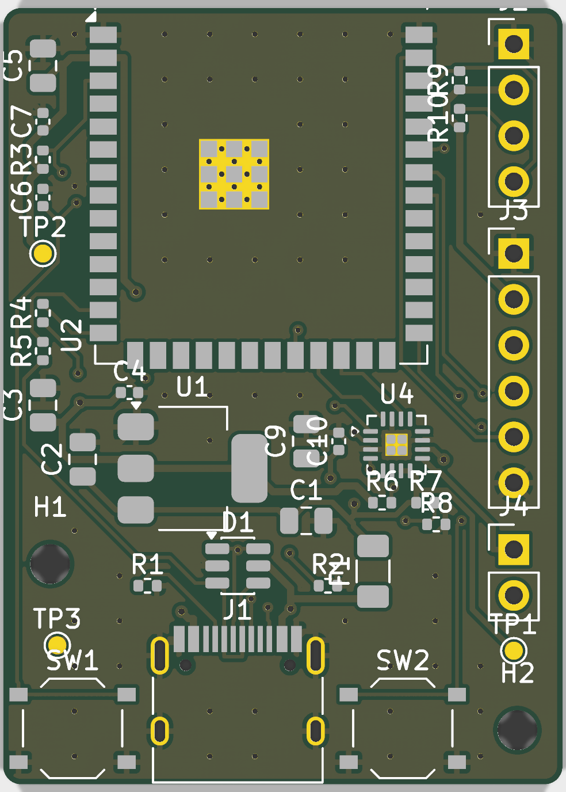
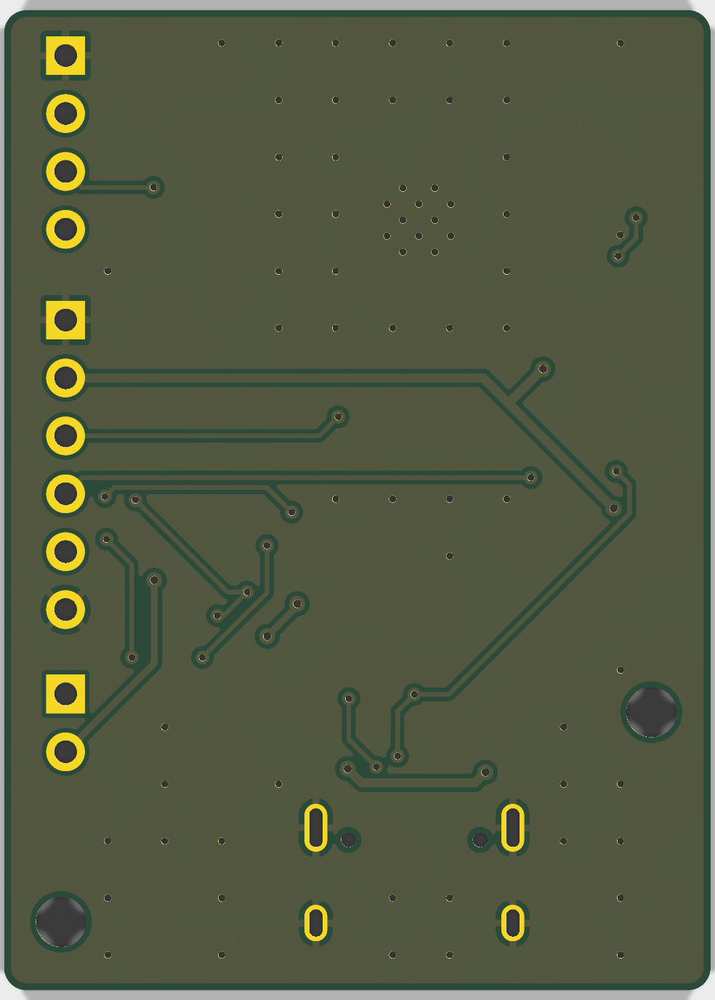

# NEO Lite — Fase 4: ruteo y DRC

PCB de 31 × 43 mm y 2 capas, completamente ruteada, con planos de GND en las dos caras.

| Resultado | Valor |
|---|---|
| DRC con paridad de esquemático (`--severity-all --schematic-parity`) | **0 conexiones pendientes, 0 errores de cobre, 0 diferencias con el esquemático** |
| Avisos aceptados | Serigrafía (`silk_overlap`, `silk_over_copper`, `silk_edge_clearance`): se limpian en la fase 5. `lib_footprint_mismatch` de U2: vías térmicas agrandadas a 0,3 mm a propósito (fase 3 § 4) |
| ERC y `verify_schematic.py` | 0/0 y OK (sin cambios) |
| Pistas | 360 tramos, 716 mm: 535 mm en la cara superior y 180 mm en la inferior |
| Vías | 81 (de ellas 54 de cosido de GND): 0,6/0,3 mm y 0,7/0,35 mm, sin suplemento en JLCPCB |
| Cobre más allá del borde superior (antena) | Ninguno |
| Imágenes | `docs/img/fase4_render_top.png`, `docs/img/fase4_render_bottom.png` |

## 1. Método

```
python3 tools/route_all.py          # build_pcb.py + route_pcb.py (etapas A y B) + DRC, con reintentos
```

1. `build_pcb.py` crea el PCB colocado desde la netlist (fase 3).
2. `route_pcb.py --stage route` exporta el diseño en Specctra DSN y rutea con
   [Freerouting](https://github.com/freerouting/freerouting) 2.1.0 en modo consola (Java 21, un
   solo hilo). Lo hace desde una copia del PCB con franjas de exclusión de 0,30 mm en el contorno,
   porque Freerouting no aplica la separación cobre-borde de KiCad. Importa el resultado (SES) y
   quita los tramos duplicados (ida y vuelta) o colgantes que deja Freerouting.
3. `route_pcb.py --stage planes` añade zonas de GND en las dos caras, con conexión directa para
   los pads expuestos de U2 (módulo) y U4 (amplificador) y alivio térmico para el resto. Rellena,
   cose las dos caras con vías de GND en rejilla de 2,5 mm donde hay relleno en ambas, y quita las
   vías de cosido que no quedan dentro del relleno.
4. `route_all.py` repite el ciclo hasta que el DRC queda limpio. Freerouting 2.1 no es del todo
   determinista, y pcbnew falla de vez en cuando al importar: cada etapa va en su propio proceso
   y se reintenta si el proceso muere. Si un intento no queda limpio, se registra qué falla.
   Para el resultado entregado hicieron falta 2 intentos: el primero dejó sin rutear AMP_SD.

Freerouting no está en el repositorio: se descarga de las versiones publicadas en GitHub
(`freerouting-2.1.0.jar`) y se indica con la variable `FREEROUTING_JAR`.

## 2. Anchuras por clase de neta

| Clase | Netas | Pista | Motivo |
|---|---|---|---|
| Power | VBUS, +3V3 | 0,4 mm | Corriente de pico ≤ 0,6 A en VBUS y 0,4 A en +3V3; > 1,2 A admisibles en cobre exterior de 1 oz |
| PowerQFN | +5V | 0,3 mm | Llega a los pines de 0,5 mm de paso del MAX98357A. Freerouting usa una sola anchura por neta |
| GND | GND | 0,3 mm (0,25 en las entradas a pines finos) | Además de los planos |
| Speaker | SPK_P, SPK_N | 0,3 mm | Pines de 0,5 mm de paso; ~0,2 A eficaces a 0,8 W en 8 Ω |
| USB | USB_DP/DN, ESP_DP/DN | 0,2 mm | Pares entrelazados del USB-C a 0,5 mm de paso; a 12 Mbit/s y con menos de 3 cm no hace falta impedancia controlada |
| Default | Señales | 0,2 mm | — |

Separación mínima de 0,15 mm (0,2 mm en la clase Power). JLCPCB admite 0,127 mm en 2 capas.

## 3. Cambios respecto a la fase 3

| Cambio | Motivo |
|---|---|
| U1 sube 0,3 mm (y = 125,5) y D1 pasa a y = 130,9 | Más hueco entre D1 y los pines D+/D− del USB-C, la conexión que más fallaba, sin solapar los patios |
| Clases USB y Speaker con "/" en el patrón | Las netas con etiqueta local se llaman `/USB_DP`, `/SPK_P`…; antes esas clases no se aplicaban |
| Clases de potencia a 0,3–0,4 mm (antes 0,6 mm) | Una pista de 0,6 mm no puede entrar en los pines de 0,5 mm de paso del MAX98357A sin violar la separación |

## 4. Revisión visual





La cara superior lleva el 75 % del ruteo. El plano de GND inferior queda casi entero: lo cruzan
unas pocas pistas cortas, sobre todo las del micrófono (MIC_SCK y MIC_SD) hacia J3, sin partirlo
en islas. El borde superior, junto a la antena del módulo, tiene cobre de GND y vías de cosido en
las dos caras, como pide Espressif.

## 5. Pendiente para la fase 5 (fabricación)

1. Limpieza de serigrafía: referencias de pasivos a la capa de fabricación y referencias de
   conectores y pulsadores recolocadas sin solapes. También los rótulos de J2/J3/J4 (OLED, MIC,
   SPK +/−).
2. Gerber, taladros, BOM y CPL de JLCPCB, con la tabla de rotaciones a revisar en la vista previa.
3. Revisión DFM: confirmar en el pedido que JLCPCB acepta el módulo con la antena sobresaliendo
   del borde.
