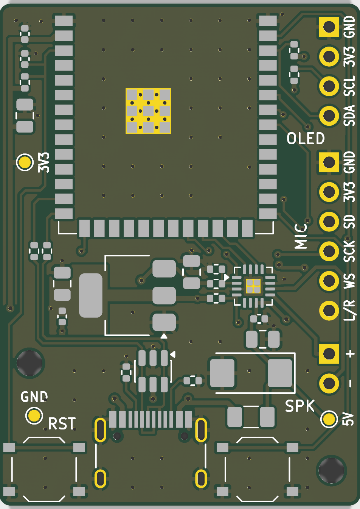
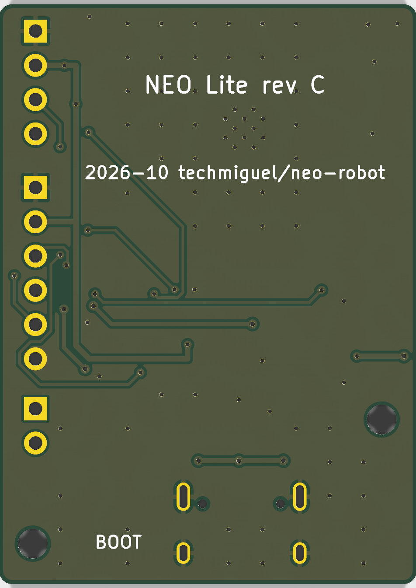

# NEO Lite — Fase 5: fabricación (actualizada a la revisión C)

Paquete para pedir a JLCPCB 5 placas de 2 capas con montaje SMT por la cara superior: serigrafía
limpia y rotulada, Gerber y taladros, BOM y CPL, comprobación de las huellas contra las de la vista
previa de JLCPCB y lista de revisión previa al pedido.

El paquete corresponde a la **revisión C**, la que sale de la revisión de la fase 6
(`fase6-revision.md`).

Todo se regenera desde `hardware/neo-lite`:

```
python3 tools/route_all.py        # PCB ruteado (fases 4 y 6)
python3 tools/silk_cleanup.py     # serigrafía y rótulos
python3 tools/review_pcb.py       # comprobaciones de la fase 6
python3 tools/fab_outputs.py      # production/ y docs/data/jlc_rotaciones.csv
python3 tools/bom_fase1.py        # stock, precio y coste (consulta la API de JLCPCB)
```

| Comprobación | Resultado |
|---|---|
| DRC con paridad de esquemático | **0 errores, 0 conexiones pendientes, 0 diferencias** |
| Avisos aceptados | 5 × `lib_footprint_mismatch` (U2, J1–J4): huellas modificadas a propósito (vías térmicas de U2; serigrafía del contorno movida a F.Fab). 1 × `silk_over_copper`: triángulo de pin 1 de U4 recortado en parte por la máscara de R7 (fase 6 § 4) |
| `review_pcb.py` (fase 6) | 24 de 24 comprobaciones OK |
| ERC y `verify_schematic.py` | 0/0 y OK |
| BOM de fabricación | 19 grupos, 26 piezas; **idéntica a la de la fase 1** (referencias y códigos LCSC; `fab_outputs.py` falla si no) |
| CPL | 26 piezas, las mismas referencias que la BOM, todas en la cara superior |
| Stock (API de JLCPCB, 12-10-2026) | Todas las piezas con stock; la más justa, C1 (TPSC476K016R0350), con 397 unidades para 5. Alternativa con la misma huella: TAJC476K016RNJ (C7219) |

## 1. Contenido de `production/`

| Archivo | Contenido |
|---|---|
| `NEO_Lite_gerber.zip` | **Lo que se sube a JLCPCB**: el contenido de `gerber/` |
| `gerber/*.gtl, *.gbl` | Cobre superior e inferior |
| `gerber/*.gts, *.gbs, *.gtp, *.gbp` | Máscara y pasta de las dos caras (pasta inferior vacía) |
| `gerber/*.gto, *.gbo` | Serigrafía, recortada por la máscara |
| `gerber/*.gm1` | Contorno |
| `gerber/NEO_Lite-PTH.drl`, `NEO_Lite-NPTH.drl` | Taladros Excellon en mm, metalizados y no metalizados por separado, con mapas Gerber X2 |
| `NEO_Lite_BOM_JLC.csv` | BOM: Comment, Designator, Footprint, LCSC Part # |
| `NEO_Lite_CPL_JLC.csv` | Posiciones: Designator, Mid X, Mid Y, Layer, Rotation |

Gerber sin atributos X2 de red y con extensiones Protel, como pide JLCPCB. Origen absoluto, igual
en Gerber, taladros y CPL (la Y del CPL sale negativa porque KiCad la invierte igual que en el
Gerber; es coherente).

## 2. Formulario de pedido

| Parámetro | Valor | Nota |
|---|---|---|
| Capas | 2 | |
| Tamaño | 31 × 43 mm | Más los 6,3 mm de antena del módulo que sobresalen (no son placa) |
| Cantidad | 5 | |
| Grosor | 1,6 mm | |
| Acabado | HASL sin plomo | Suficiente para el TQFN de 0,5 mm y el módulo. ENIG si se prefiere más planitud (cuesta más) |
| Taladro mínimo | 0,3 mm (vías) | Sin suplemento |
| Número de pedido | "Specify a location" o "Remove" | Si no, JLCPCB lo imprime donde quiere |
| Montaje | PCBA Economic, cara superior, 5 placas | |
| Bordes de proceso | Los que pida la revisión DFM | Ver § 4.1 |

Coste estimado (`bom_fase1.py`, precios del 12-10-2026): **80,08 USD sin envío ni impuestos** (16,02
por placa). En la revisión B eran 73,24; la diferencia es el tántalo C1: pieza extendida (+3,07) y el
precio de las 5 unidades.

## 3. Serigrafía





`tools/silk_cleanup.py`:

1. Pasa todas las referencias a F.Fab. Siguen en el plano de montaje, pero no se imprimen: en
   31 × 43 mm no caben legibles sin pisar pads.
2. Pasa a F.Fab los trazos de serigrafía que cruzaban el borde: el contorno del módulo junto a la
   antena y el de las tiras de pines.
3. Coloca rótulos de banco que no pisan pads, taladros, otra serigrafía ni el borde (vías
   tapadas, que la serigrafía puede cubrir):
   - **J2:** GND, 3V3, SCL, SDA y "OLED".
   - **J3:** GND, 3V3, SD, SCK, WS, L/R y "MIC".
   - **J4:** + y − con "SPK".
   - **Pulsadores:** RST y BOOT.
   - **Puntos de prueba:** 5V, 3V3 y GND.
   - **Cara inferior:** "NEO Lite rev C" y la referencia al repositorio. El rótulo BOOT también va
     en la cara inferior: arriba no cabe.

Altura mínima de texto: 0,8 mm (regla de KiCad). Grosor de trazo mínimo: 0,15 mm (recomendación de
JLCPCB). Los rótulos de pin van en vertical con anchura de carácter de 0,65 mm, para caber a 2,54 mm
de paso.

## 4. Revisión previa al pedido

### 4.1 Revisión DFM

El módulo sobresale 6,3 mm por el borde superior. Es la posición que recomienda Espressif para la
antena, pero no he encontrado una norma escrita de JLCPCB sobre piezas que sobresalen. Al subir
los archivos, comprobar el resultado de la revisión DFM y aceptar los bordes de proceso
(*edge rails*) si los proponen; cuestan poco y sostienen la placa en la máquina.

### 4.2 Vista previa del montaje: rotaciones

`fab_outputs.py` compara cada huella de KiCad con la huella EasyEDA que JLCPCB usa en su vista
previa (`docs/data/jlc_rotaciones.csv`). Las piezas giradas respecto a EasyEDA pueden aparecer
giradas en la vista previa. Hay que comprobar el pin 1 de cada una y, si hace falta, corregir el
giro en la propia herramienta de JLCPCB antes de confirmar.

| Pieza | Giro KiCad → EasyEDA | Qué comprobar en la vista previa |
|---|---|---|
| C1 (tántalo, caja C) | 0° | **Polaridad**: banda (+) hacia la derecha, hacia J4 (en la placa, pad 1 a la derecha). Comprobado que en las dos huellas el pad 1 es el positivo |
| D1 (USBLC6-2SC6, SOT-23-6) | 270° | Pin 1 arriba a la derecha (placa girada 270° en KiCad; triángulo de serigrafía) |
| U1 (TLV1117LV33, SOT-223) | 180° | Lengüeta (OUT) a la izquierda, hacia el módulo; pines 1–3 a la derecha (U1 va girado 180° en la placa) |
| U4 (MAX98357A, TQFN-16) | 270° | Pin 1 arriba a la izquierda (marca de pin 1 de la serigrafía) |
| SW1, SW2 (TS-1187A) | 270° | Simétrico: cualquier giro de 90° monta igual |
| U2 (WROOM-1) | 0° | Antena hacia fuera de la placa |

Desviaciones de pads que la tabla marca y que **no son errores**, revisadas pad a pad:

- **U1:** EasyEDA numera la lengüeta como pin 4 y KiCad como pin 2. Con el giro, los pines 1–3
  coinciden.
- **U2:** solo difiere el pad central de GND, que EasyEDA divide en varios. Los 40 pines de señal
  coinciden.
- **SW1/SW2:** EasyEDA numera los pads 1–4 y KiCad 1-1-2-2.

- **C1:** separación de pads de ±2,47 mm en KiCad y ±2,96 mm en EasyEDA. Las dos cubren los
  terminales de la caja C y el pad 1 es el positivo en ambas.

El resto de grupos (pasivos, USB-C, fusible) coincide en giro y en pads con una desviación de
0,08 mm o menos.

**Huella del MAX98357A.** La de KiCad (`TQFN-16-1EP_3x3mm_P0.5mm_EP1.23x1.23mm`) está hecha para la
variante T1633-5 del plano 21-0136 de Maxim. El MAX98357A usa la T1633+4, con el mismo pad
expuesto (1,10 mm nominal, 0,95–1,25 mm; hoja de datos, p. 37). Solo cambia 0,05 mm la longitud de
los terminales, que el pad de 0,825 mm de la huella cubre. La huella de LCSC (pad expuesto de
1,5 mm) es su versión genérica. La de KiCad es correcta.

### 4.3 Lista de comprobación

1. Subir `NEO_Lite_gerber.zip` y comprobar en el visor de JLCPCB: 2 capas, 31 × 43 mm, contorno con
   esquinas redondeadas, serigrafía legible y ningún rótulo cortado.
2. Activar el montaje: subir `NEO_Lite_BOM_JLC.csv` y `NEO_Lite_CPL_JLC.csv`. Las 19 líneas deben
   casar con su código LCSC y no debe haber piezas "no encontradas".
3. Revisar las rotaciones de § 4.2 en la vista previa, y sobre todo la polaridad de C1.
4. Confirmar stock en el momento del pedido (cambia a diario).
5. Revisión DFM (§ 4.1).

## 5. Piezas que se compran aparte

| Pieza | Cantidad por placa | Nota |
|---|---|---|
| Tira macho 1 × 4, 2,54 mm | 1 | J2, OLED |
| Tira macho 1 × 6, 2,54 mm | 1 | J3, micrófono |
| Tira macho 1 × 2, 2,54 mm | 1 | J4, altavoz |
| Módulo OLED SSD1306 0,96" I2C | 1 | GND, VCC, SCL, SDA |
| Módulo micrófono INMP441 | 1 | Cablear por nombre de pin, no por posición |
| Altavoz 8 Ω, ≥ 1 W | 1 | Entre + y −; **ninguno de los dos a GND** |
| Cable USB-C | 1 | Datos y alimentación |

Las tiras van soldadas a mano. Las de 90° caben en la misma huella si la caja es baja.

## 6. Puesta en marcha en el banco

1. Sin módulos conectados, conectar USB y medir: TP1 (5V) ≈ 4,8–5,1 V; TP2 (3V3) = 3,3 V ± 3 %.
2. El PC debe ver un puerto "USB JTAG/serial debug unit" (VID 303A). Si no aparece, mantener BOOT,
   pulsar RST y soltar BOOT.
3. Cargar un firmware de prueba (fase 6) con `ARDUINO_USB_CDC_ON_BOOT=1` y comprobar la consola
   serie por USB.
4. Conectar la OLED (J2) y comprobar la imagen (I2C en GPIO2 = SDA, GPIO42 = SCL).
5. Conectar el altavoz (J4) y reproducir un tono con GPIO40 a nivel alto.
6. Conectar el INMP441 (J3) y comprobar el nivel de captura; después, la detección de la wake word.
7. Probar el alcance Wi-Fi ya dentro de la caja: la antena sobresale y necesita espacio libre.

## 7. Riesgos residuales

| Riesgo | Mitigación |
|---|---|
| JLCPCB rechaza o pide cambios por el módulo que sobresale | Bordes de proceso; en el peor caso, montaje a mano del módulo (castellado, fácil de soldar) |
| Giros en la vista previa | Revisión de § 4.2 antes de confirmar |
| Pico de corriente con el altavoz a volumen máximo en un puerto USB 2.0 débil | Altavoz de 8 Ω y volumen limitado por firmware (fase 1 § 2.6) |
| Rendimiento Wi-Fi dentro de la caja | Espacio libre alrededor de la antena; prueba de alcance en la puesta en marcha |
| Módulo especificado hasta 65 °C de ambiente (PSRAM octal) | Caja ventilada y lejos de fuentes de calor |
