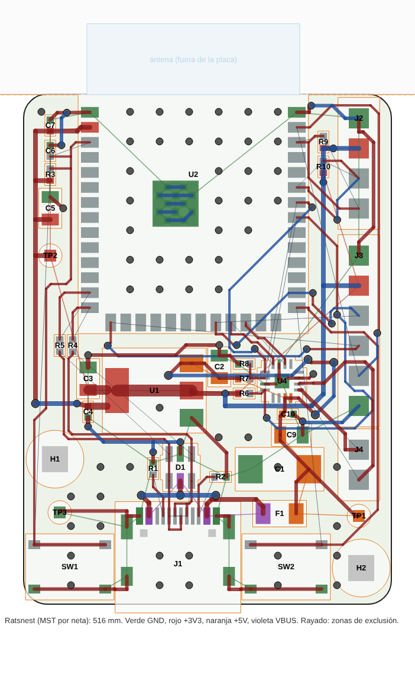

# NEO Lite — Fase 6: revisión del PCB antes de fabricar (revisión C)

La revisión B pasaba el DRC sin errores, pero el DRC solo comprueba reglas geométricas. Esta fase
revisa el PCB buscando errores de concepto y de ruteo que el DRC no ve. Corrige todo lo encontrado
y deja las comprobaciones en un script (`tools/review_pcb.py`) para que no vuelvan a aparecer.

| Resultado | Valor |
|---|---|
| Hallazgos | 8 (2 graves, 4 medios, 2 leves), todos corregidos |
| Cambios de esquemático | C1 pasa de cerámico de 10 µF a tántalo de 47 µF/16 V con ESR de 0,35 Ω (amortiguación del enchufado en caliente) |
| DRC con paridad de esquemático | **0 errores, 0 conexiones pendientes, 0 diferencias**. Avisos aceptados: 5 × `lib_footprint_mismatch` (U2, J1–J4, modificadas a propósito) y 1 × `silk_over_copper` (§ 4) |
| `review_pcb.py` | **24 de 24 comprobaciones OK** (`docs/data/revision_pcb.csv`) |
| ERC y `verify_schematic.py` | 0/0 y OK |
| Coste (5 placas, PCBA económico) | 80,08 USD sin envío ni impuestos (16,02 por placa); revisión B: 73,24. La diferencia es el tántalo: pieza extendida (+3,07) y 5 unidades a 0,82 |

Regeneración completa:

```
python3 tools/gen_schematic.py && python3 tools/verify_schematic.py
python3 tools/route_all.py        # build_pcb (con preroute) + Freerouting + planos + DRC + review_pcb --route
python3 tools/silk_cleanup.py
python3 tools/review_pcb.py       # revisión completa -> docs/data/revision_pcb.csv
python3 tools/fab_outputs.py
python3 tools/bom_fase1.py
python3 tools/hotplug_sim.py      # tabla del § 2.1
```

## 1. Hallazgos

| # | Hallazgo en la revisión B | Gravedad | Corrección en la revisión C |
|---|---|---|---|
| 1 | Al enchufar en caliente, el cable (L) y los cerámicos de +5V forman un LC poco amortiguado. El pico puede llegar a 7–8,5 V; TLV1117LV y MAX98357A admiten 6 V como máximo absoluto | Grave | C1 de tántalo de 47 µF con ESR de 0,35 Ω (§ 2.1) |
| 2 | El frente del USB-C quedaba 0,35 mm por dentro del borde. Con muchos cables la carcasa del conector no llega a asentar | Grave (mecánica) | J1 baja 0,65 mm: el frente sobresale 0,3 mm |
| 3 | Par USB desigual: D+ con 3 vías y 11 mm por la cara inferior, D− sin vías y 2,2 mm más corto | Medio | Par pre-ruteado sin vías y en la cara superior, con D1 en flujo continuo (§ 2.2) |
| 4 | Desacoplo lejos del pin: C7 (100 nF) a 5,2 mm del pin 3V3 del módulo; C10 y C9 a 4,1 y 5,3 mm de los VDD del amplificador | Medio | Reubicados (§ 2.3) |
| 5 | La lengüeta de U1 (SOT-223) solo tenía ~6 mm² de cobre de +3V3 | Medio | U1 girado 180° y zona de +3V3 junto a la lengüeta (§ 2.4) |
| 6 | 9 tramos de la cara superior bajo el cuerpo del módulo partían el GND superior bajo el ESP32-S3 | Medio | Exclusión de pistas superiores bajo el módulo en el ruteo |
| 7 | 2 ángulos agudos entre tramos de pista | Leve | `route_all.py` rechaza los resultados con ángulos agudos |
| 8 | Texto de serigrafía de 0,12 mm de trazo (JLCPCB recomienda 0,15 mm) | Leve | 0,15 mm |

Comprobado sin problemas: sin vías en pads; anillo de vía de 0,15 mm; aperturas de máscara
(U4 0,12 mm, J1 0,2 mm); planos de GND; pines de arranque (GPIO0/3/45/46); RC de EN; pull-ups
I2C; SD_MODE y L/R del amplificador; resistencias CC; ESD.

## 2. Correcciones

### 2.1 Enchufado en caliente: C1 de tántalo

El cable USB tiene unos 0,5–2 µH de inductancia. Con unas decenas de µF de cerámicos de ESR
mínima, el circuito apenas se amortigua: al enchufar, la tensión en +5V puede llegar casi al doble
de VBUS (Linear Technology AN-88; TI SLVA936). La solución habitual es un condensador en paralelo
con una ESR del orden de √(L/C), entre 0,1 y 0,4 Ω aquí.

`tools/hotplug_sim.py` simula el escalón de 5,25 V sobre el cable, los contactos y el PPTC (L, R)
y los cerámicos de +5V (Ceff, ya reducida por la tensión continua):

| L (µH) | R (Ω) | Ceff (µF) | sin C1 | 47 µF / 1 Ω (TAJ, caja B) | 47 µF / 0,5 Ω (TAJ, caja C) | 47 µF / 0,35 Ω (TPS, caja C) |
|---|---|---|---|---|---|---|
| 0.5 | 0.10 | 15 | **7.30** | **6.26** | 5.59 | 5.21 |
| 0.5 | 0.10 | 30 | **6.55** | 5.84 | 5.38 | 5.14 |
| 0.5 | 0.15 | 15 | **6.46** | 5.45 | 4.91 | 4.95 |
| 0.5 | 0.15 | 30 | 5.75 | 5.04 | 4.86 | 4.90 |
| 0.5 | 0.25 | 15 | 5.50 | 4.67 | 4.60 | 4.62 |
| 0.5 | 0.25 | 30 | 5.25 | 4.60 | 4.48 | 4.47 |
| 1.0 | 0.10 | 15 | **7.99** | **6.58** | 5.81 | 5.46 |
| 1.0 | 0.10 | 30 | **7.30** | **6.33** | 5.81 | 5.57 |
| 1.0 | 0.15 | 15 | **7.21** | 5.86 | 5.13 | 5.01 |
| 1.0 | 0.15 | 30 | **6.45** | 5.53 | 5.04 | 4.94 |
| 1.0 | 0.25 | 15 | **6.13** | 4.85 | 4.64 | 4.66 |
| 1.0 | 0.25 | 30 | 5.50 | 4.62 | 4.51 | 4.51 |
| 2.0 | 0.10 | 15 | **8.58** | **6.74** | 5.97 | 5.77 |
| 2.0 | 0.10 | 30 | **7.99** | **6.71** | **6.18** | **6.03** |
| 2.0 | 0.15 | 15 | **7.91** | **6.12** | 5.38 | 5.22 |
| 2.0 | 0.15 | 30 | **7.20** | 5.98 | 5.48 | 5.37 |
| 2.0 | 0.25 | 15 | **6.88** | 5.20 | 4.68 | 4.75 |
| 2.0 | 0.25 | 30 | **6.13** | 4.97 | 4.65 | 4.65 |

Pico en +5V en voltios; en negrita, por encima de los 6 V. R incluye cable, contactos y PPTC.

Elegido: **AVX TPSC476K016R0350** (LCSC C444805), 47 µF, 16 V, ESR de 0,35 Ω, caja C (6032). Se
eligió por tres motivos:

1. La serie TPS se ensaya al 100 % frente a sobrecorriente, que es justo lo que sufre un
   condensador en una entrada que se enchufa en caliente.
2. A 16 V trabaja al 33 % de su tensión nominal. AVX recomienda no pasar del 50 % en circuitos de
   baja impedancia.
3. Con su ESR el pico queda por debajo de 5,6 V en todos los casos realistas.

El único caso que roza los 6 V (6,03 V) combina 2 µH con solo 0,1 Ω en total. No es realista: un
cable con 2 µH mide 2 m o más, y entonces sus conductores de VBUS y GND ya suman bastante más de
0,1 Ω.

Alternativa con el mismo encapsulado si se agota (stock: 397): **TAJC476K016RNJ** (C7219, 0,5 Ω,
26 824 en stock), con un pico de 6,2 V en el mismo caso extremo. El de 47 µF/10 V y 1 Ω que se
barajó al principio (C22036) no basta: llega a 6,7 V.

C1 sustituye al cerámico de 10 µF que hacía de bulk en +5V (bajar la capacidad cerámica también
ayuda). En la placa va junto a F1, con el positivo hacia J4.

Contrapartida: la capacidad en +5V pasa de unos 30 a unos 67 µF. Ya superaba los 10 µF que la
especificación USB 2.0 admite en la conexión, y ahora lo hace por más. La corriente de conexión
queda limitada por la ESR de C1, el cable y el PPTC. Con puertos de PC y cargadores no es un
problema práctico. Un concentrador sin alimentación muy justo podría notar una caída breve.

### 2.2 Par USB sin vías

`tools/preroute.py` traza el par antes de Freerouting, como pistas bloqueadas. KiCad las exporta
al DSN como `(type fix)` y la importación del SES las conserva.

- **En el USB-C:** D− une B7 y A7 por debajo de la fila de pads y D+ une A6 y B6 por encima. Así
  cada línea sale sin cruzarse con la otra: D− por la izquierda, D+ por la derecha.
- **D1 en flujo continuo**, como recomienda ST para el USBLC6-2SC6. Está girado 270° sobre el
  conector y cada línea pasa por debajo del encapsulado de un pin al gemelo (D− de 4 a 3, D+ de 6
  a 1), sin derivaciones. El VBUS y el GND de D1 bajan con una vía cada uno en el hueco entre las
  dos líneas.
- **Recorrido hasta el módulo:** el par va a la izquierda por debajo de U1 y sube pegado al
  módulo. R5/R4 (22 Ω) quedan una junto a otra a 3 mm de los pines 13/14. El par entra en los
  pines sin cruzarse: D− arriba (GPIO19) y D+ abajo (GPIO20).

Resultado: 0 vías, todo en la cara superior sobre el GND inferior continuo, pistas de 0,2 mm a
0,4 mm entre ejes. La diferencia de longitud depende de qué fila del USB-C use el cable:

| Orientación del cable | D+ | D− | Diferencia |
|---|---|---|---|
| A (A6/A7) | 30,2 mm | 33,1 mm | 2,8 mm |
| B (B6/B7) | 29,2 mm | 29,8 mm | 0,5 mm |

Con el cable en la orientación A, D− recorre además el puente de 3,3 mm bajo los pads. Esa diferencia es inherente al USB-C: las dos filas del receptáculo se cruzan.

A 12 Mbit/s el bit dura 83 ns; 3 mm son unos 20 ps.

Que el par vaya pegado al módulo deja libre la franja del borde izquierdo. Por ahí suben, también
pre-ruteados, el +3V3 de la columna izquierda y EN, desde el pulsador RESET. El +3V3 cruza el par
una sola vez, en perpendicular y por la cara inferior (vías junto a C4 y en el borde).

### 2.3 Desacoplo

| Condensador | Pin | Revisión B | Revisión C (camino por pista) |
|---|---|---|---|
| C7 100 nF | U2.2 (3V3) | 5,2 mm | 3,5 mm |
| C10 100 nF | U4.7/8 (VDD) | 4,1 mm | 1,5 mm |
| C9 10 µF | U4.7/8 (VDD) | 5,3 mm | 3,3 mm |

C7 pasa a ser el primero de la columna izquierda, a la altura del pin 3V3. Su GND va directo al
pin 1 (GND) del módulo y a una vía. C10 y C9 van bajo los pines VDD del MAX98357A; R6–R8 pasan al
lado de SD_MODE/GAIN, junto a los pines 2 y 4.

### 2.4 Disipación de U1

U1 se gira 180°: la lengüeta (+3V3) mira al módulo y la entrada (+5V) al amplificador y a la
entrada de alimentación. Así el +5V queda agrupado a la derecha (F1, C1, C2, U4, C9, C10) y el
+3V3 a la izquierda.

La lengüeta se une al pin 2 con una pista de 1 mm por debajo del encapsulado. C3 y C4 van junto a
la lengüeta. El ruteo deja libre el rectángulo de alrededor para una zona de +3V3 en la cara
superior, con prioridad sobre el GND: 26 mm² de zona además de los 7,6 mm² de la lengüeta.

Disipación media estimada: 0,15 A × 1,7 V ≈ 0,26 W. Con unos 30 mm² de cobre en un SOT-223 son
unos 25–30 °C de subida, frente a unos 35 °C con solo la lengüeta. Los picos de Wi-Fi (~0,5 A,
0,85 W) duran milisegundos y no llegan a calentar.

### 2.5 GND bajo el módulo

En la copia del DSN se excluyen pistas y vías de la cara superior bajo el cuerpo del módulo. El GND
superior queda entero entre las filas de pads, como en el módulo de referencia. Las vías de cosido
se añaden después, sobre los dos planos.

## 3. Cambios de colocación



| Pieza | Revisión B | Revisión C | Motivo |
|---|---|---|---|
| J1 | (113,0; 139,0) | (113,0; 139,65) | Sobresale 0,3 mm (hallazgo 2) |
| D1 | (113,0; 130,9), 0° | (113,2; 131,5), 270° | Flujo continuo del par |
| R4, R5 | Columna izquierda, verticales en fila | (104,1 / 103,0; 121,2) | En el recorrido del par, bajo los pines 13/14 |
| U1 | (110,5; 125,5), 0° | (111,0; 125,0), 180° | Lengüeta hacia el módulo |
| C3, C4 | Columna izquierda / junto a U1 | Junto a la lengüeta | Desacoplo y zona de +3V3 |
| C9, C10, R6–R8 | A la izquierda de U4 | C9/C10 bajo VDD, R6–R8 a la izquierda | Desacoplo |
| C1 | 10 µF 0805 | Tántalo caja C junto a F1 | Hallazgo 1 |
| C7, C6, R3, C5 | C5, C7, R3, C6 (de arriba abajo) | C7, C6, R3, C5 | 100 nF junto al pin 3V3 y RC de EN junto al pin EN |
| R1 | (108,0; 132,0) | (110,9; 131,6), 90° | CC1 sale sin cruzar VBUS ni el par |
| F1, R2, C2 | — | Reubicados; C2 girado 90° | Flujo de +5V y vía de GND de C2 |

## 4. Ruteo

`tools/preroute.py` fija 113 tramos y 18 vías: lo que decide la calidad o lo que Freerouting no
resolvía por sí solo. Comprende:

- el par USB, VBUS y CC1/CC2;
- la lengüeta de U1 con C3/C4;
- el +3V3 de la columna izquierda (cruza bajo el par) y su tronco por la cara inferior hasta J2/J3;
- EN desde el pulsador RESET;
- los puentes entre los pads gemelos de los pulsadores;
- los GND de U4, C2, C9/C10 y de la columna izquierda.

Freerouting rutea el resto. Cada intento de `route_all.py` se acepta solo con el DRC limpio y las
comprobaciones de ruteo de `review_pcb.py` sin fallos. Para llegar a un resultado aceptable se
añadieron tres mecanismos:

1. `--router.job_timeout`. Freerouting 2.1 no respeta `-mp` mientras queda algo sin rutear; con
   este límite termina y escribe el SES.
2. Conexión directa automática en los pads SMD de GND a los que el plano solo llega con un radio
   (`starved_thermal`).
3. Vías de cosido en los fragmentos de plano que no tienen ninguna. Un ejemplo es una isla del GND
   inferior que encierran pistas bajo el lado derecho del módulo.

Resultado: 297 tramos y 605 mm (435 mm en la cara superior y 171 mm en la inferior), y 89 vías,
55 de ellas de cosido. Todos los taladros son de 0,3 o 0,35 mm y las pistas van de 0,2 a 1,0 mm.

Dos decisiones conscientes:

- **Pistas inferiores bajo el módulo.** Bajo el lado derecho del módulo quedan algunas pistas de
  señal en la cara inferior: MIC_WS, SPK_DIN y AMP_SD, desde la columna de pines de la derecha
  hacia U4. La cara superior, que es la referencia del módulo, sigue entera. El plano inferior
  queda cosido a ella alrededor de esas pistas.
- **Pad expuesto del MAX98357A sin vías.** La huella de KiCad lleva aperturas de pasta, no vías,
  y poner vías en el pad expuesto absorbería soldadura. Con ~0,1 W de disipación a 0,8 W de
  salida, basta el cobre superior. Los tres pines GND se unen al pad expuesto y hay dos vías de
  GND junto al pin 11 y a C9/C10.

Aviso aceptado: el triángulo de pin 1 de U4 queda en parte bajo la apertura de máscara de R7, que
ahora está junto a U4. La máscara lo recorta, pero el resto del triángulo sigue marcando el pin 1.

## 5. Resultado


`tools/review_pcb.py` (en `docs/data/revision_pcb.csv`):

| Comprobación | Valor | Límite | Resultado |
|---|---|---|---|
| USB-C: el frente sobresale del borde | 0.25 mm | >= 0.2 mm | OK |
| USB-C: todos los pads dentro de la placa | sí | a >= 0.3 mm del borde | OK |
| USB: vías en el par | 0 | 0 | OK |
| USB: tramos fuera de la cara superior | 0 | 0 | OK |
| USB: longitudes, orientación A (A6/A7) | D+ 30.2 mm, D- 33.1 mm, diferencia 2.8 mm | <= 3.0 mm | OK |
| USB: longitudes, orientación B (B6/B7) | D+ 29.2 mm, D- 29.8 mm, diferencia 0.5 mm | <= 3.0 mm | OK |
| Desacoplo C7.1 -> U2.2 (+3V3) | 3.5 mm por pista | <= 4.0 mm | OK |
| Desacoplo C5.1 -> U2.2 (+3V3) | 13.5 mm por pista | <= 15.0 mm | OK |
| Desacoplo C10.1 -> U4.7 (+5V) | 1.5 mm por pista | <= 2.0 mm | OK |
| Desacoplo C9.1 -> U4.7 (+5V) | 3.3 mm por pista | <= 4.0 mm | OK |
| Desacoplo C2.1 -> U1.3 (+5V) | 2.9 mm por pista | <= 3.5 mm | OK |
| Desacoplo C3.1 -> U1.2 (+3V3) | 2.5 mm por pista | <= 3.5 mm | OK |
| Desacoplo C4.1 -> U1.2 (+3V3) | 3.2 mm por pista | <= 3.5 mm | OK |
| Desacoplo C6.1 -> U2.3 (/EN) | 4.3 mm por pista | <= 5.0 mm | OK |
| Vías dentro de pads SMD | ninguna | ninguna | OK |
| Pistas de la cara superior bajo el módulo | 0 tramos | 0 | OK |
| Ángulos agudos entre tramos | ninguno | ninguno (< 90°) | OK |
| Serigrafía: grosor de trazo | 22 textos, 0 finos | >= 0.15 mm | OK |
| Serigrafía: altura de texto | 0 bajos | >= 0.8 mm | OK |
| Cobre de +3V3 junto a la lengüeta de U1 | 26 mm² de zona (+ 7.6 de lengüeta) | >= 20 mm² | OK |
| Pistas y vías a >= 0,3 mm del borde | 0 fuera | 0 | OK |
| Cobre por encima del borde superior (antena) | 0 | 0 | OK |
| Pad expuesto U2.41 con conexión directa al GND | sí | directa | OK |
| Pad expuesto U4.17 con conexión directa al GND | sí | directa | OK |
