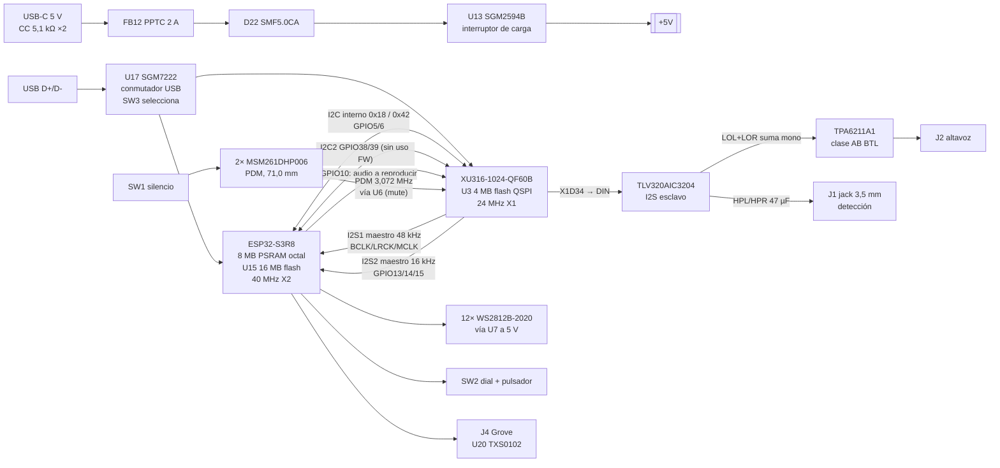

# NEO v2 — Fase 1: lectura del diseño original (Home Assistant Voice PE)

Documento de trabajo. Diseño de referencia: Home Assistant Voice Preview Edition,
© Nabu Casa, Inc., licencia CERN-OHL-P v2. Todo lo que este documento describe del
hardware original procede de sus archivos públicos; las conclusiones e
interpretaciones son mías y se marcan como tales.

## 0. Fuentes y método

La conectividad no se ha leído "a ojo" del PDF del esquemático, sino extrayendo la
netlist del archivo `Home Assistant Voice PE.kicad_pcb` (KiCad 9, `version 20241229`):
en el PCB cada pad lleva su net ya resuelta, lo que da una netlist exacta. El script
es `hardware/neo-v2/tools/extract_voicepe.py` y las tablas generadas están en
`hardware/neo-v2/docs/data/`. Cualquier fila de este documento se puede reproducir.

| Fuente | Qué se usó | Estado |
|---|---|---|
| `NabuCasa/home-assistant-voice-pe` @ `main`, carpeta `hardware/KiCad` | Netlist, posiciones, atributos DNP, zonas, apilado | Leído completo |
| `esphome/home-assistant-voice-pe`, `home-assistant-voice.yaml` | Pines, buses, frecuencias, modos I2S | Leído |
| `esphome/voice-kit-xmos-firmware`, `src/ffva/bsp_config/NC-VOICE-KIT` | Mapa de puertos XMOS, modo I2S, MCLK, dirección I2C | Leído |
| PDF "PCB design files" y hoja de datos del producto v1.1 (repo `NabuCasa/support`) | Apilado, impedancias, especificaciones | Leído |
| `marceldale/nest-mini-v2-voice`, `iMike78/nest-mini-drop-in-pcb` | Segunda referencia, números LCSC | Consultado |
| Páginas `support.nabucasa.com`, `voice-pe.home-assistant.io`, `ti.com`, `lcsc.com`, `jlcpcb.com` | — | **Bloqueadas** por la política de red de este entorno |

Consecuencia del último punto: ningún dato de hoja de datos de TI ni de stock de
LCSC/JLCPCB ha podido verificarse aquí. Donde cito un valor de hoja de datos de
memoria lo marco **[HD sin verificar]**. Lo extraído de los archivos de diseño lo
marco **[PCB]**, del firmware **[FW]**.

## 1. Hallazgos que corrigen o matizan supuestos del encargo

1. **El XMOS es el maestro de ambos buses I2S y está en serie en la ruta de
   reproducción.** El ESP32 no habla con el DAC directamente: envía el audio al
   XU316 por GPIO10 (`I2S_DIN_SEC` → `X1D00`), y es el XU316 quien lo reenvía al
   AIC3204 por `X1D34` → `DIN` (puerto `PORT_I2S_DAC_DATA`), usándolo a la vez como
   referencia de AEC. **[FW]** `platform_init.c` (modo `appconfI2S_MODE_MASTER`) y
   **[PCB]**. Implicación: si el XMOS no arranca, no hay audio de salida.
2. **El nombre de net `I2S_DIN_ESP` es engañoso:** es la salida del XMOS hacia el
   DAC; GPIO11 está conectado a ella por R97 (0 Ω) pero el YAML no lo usa. GPIO11
   **no está libre**: está atado eléctricamente al DIN del DAC.
3. **GPIO9 y GPIO12 están unidos entre sí** por R146 (0 Ω, poblada) en la net MCLK
   (24,576 MHz generados por el XMOS). Ninguno de los dos está libre.
4. **Hay un segundo bus I2C** (`I2C2`, GPIO38 SDA / GPIO39 SCL) entre ESP32 y
   XMOS (`X0D30`/`X0D29`) con pull-ups de 4,7 kΩ, llevado también al conector J3.
   El firmware XMOS v1.3.1 no lo usa (líneas comentadas en `platform_start.c`).
5. **La alimentación del DAC no tiene LDO propio en la variante fabricada:** U19
   (LC1458, LDO de 3,3 V) está marcado DNP y `+3.3VA` se alimenta desde `+3V3`
   (salida del buck) a través de la ferrita FB8 (120 Ω @ 100 MHz). El AIC3204
   genera AVDD/DVDD con sus LDO internos (`LDO_SELECT` a nivel alto por R23).
6. **El reset del DAC lo gobierna el XMOS** (`X0D32` → `RST_DAC`), no el ESP32.
7. **El amplificador se apaga por hardware al insertar el jack:** Q2 (BSS138)
   tira de `SHUTDOWN` a masa cuando `Audio_DET` = alto. GPIO47 habilita el
   amplificador a través de R36 (0 Ω) y R25 (4,7 kΩ), de modo que Q2 siempre gana.
8. **El silencio de micrófonos es doble y físico:** SW1 lleva `Mute_EN` a masa →
   `MUTE_ON` pone en alta impedancia los buffers de reloj y datos PDM (U6,
   SN74LVC125) **y** apaga el LDO de micrófonos U18 (EN vía Q4). U14 (buffer
   Schmitt) es DNP y está puenteado por R114.
9. **Flash del ESP32:** el diagrama de bloques del esquemático dice "8 MB Flash",
   pero la pieza poblada es U15 ZB25VQ128 (128 Mbit = 16 MB) y la hoja de datos del
   producto y el YAML (`flash_size: 16MB`) dicen 16 MB. U16 (W25Q256, misma posición)
   es DNP. Existe además un `home-assistant-voice.8mb.yaml`, lo que sugiere que hubo
   unidades con 8 MB. Para NEO v2: 16 MB, ZB25VQ128 o W25Q128JV.
10. **Algunas fuentes comerciales citan "AIC3202";** la pieza en el PCB y en la hoja
    de datos oficial v1.1 es TLV320AIC3204IRHBR. Me atengo al PCB.
11. **El altavoz no está documentado en ninguna fuente pública accesible** (ver §7).

## 2. Diagrama de bloques

## 3. Árbol de alimentación

### 3.1 Topología extraída [PCB]

| Carril | Fuente | Desde | Cargas | Notas |
|---|---|---|---|---|
| `VBUS` | Conector USB-C | — | U13, Q10 (detección VBUS para XMOS), TVS D22 | PPTC FB12 MF-NSMF200-2 en serie |
| `+5V` | U13 SGM2594B (interruptor de carga con `FAULT`) | `VBUS` | U10, U12, U18, Q1→LED, Q5→Grove, R39→amplificador, FB13→J3 | R65 (bypass 0 Ω) DNP |
| `+3V3` | U10 TPS62827DMQ, buck, L1 0,47 µH | `+5V` | ESP_3V3 (FB10), VDDIO XMOS (FB9), +3.3VA DAC (FB8), U17, U20, J3 (FB1), U11 | FB: 100 k/22,1 k → 0,6·(1+100/22,1) = **3,315 V**. `PG` → nada poblado (R13, R80 DNP) |
| `0.9V` → `VDD` | U12 TPS62065DSG, buck, L2 1 µH | `+5V` | Núcleo XU316 (FB7 600 Ω); PLL_AVDD (FB6) | FB: 51 k/100 k → 0,6·(1+51/100) = **0,906 V**. `MODE` a +5V (R45) → **PWM forzado** [HD sin verificar] |
| `+1V8` | U11 ME6211C18, LDO | `+3V3` (R78) | XU316 VDDIOB18, USB_VDD18, JTAG | R79 (desde +5V) DNP |
| `VDD_MIC` | U18 SGM2036-3.3, LDO | `+5V` | 2 micrófonos (100 Ω + desacoplo cada uno) | EN por Q4 ← `MUTE_ON` |
| `+3.3VA` | FB8 desde `+3V3` | `+3V3` | AIC3204 IOVDD y LDOIN | U19 LDO DNP |
| `WS2812_5V` | Q1 CJ3407 (P-MOS) | `+5V` | 12 LED + U7 | GPIO45 → Q6 → Q1 |
| `Grove_5V` | Q5 CJ3407 (P-MOS) | `+5V` | J4, U20 VCCB | GPIO46 → Q7 → Q5 |
| `/DAC/PA_5V` | R39 0 Ω | `+5V` | U9 TPA6211A1 (47 µF + 100 nF) | **Sin filtrado**: cuelga directamente de +5V |

### 3.2 Consumos estimados

Los valores de cada IC salen de hojas de datos que no he podido abrir desde este
entorno; son órdenes de magnitud de memoria y deben confirmarse en la fase 2.
Lo que sí es cálculo propio es la conversión a corriente en `+5V`
(I₅ = V·I / (5 V·η)).

| Carga | Carril | Corriente | En +5V | Base |
|---|---|---|---|---|
| ESP32-S3, pico Wi-Fi TX 802.11b 21 dBm | 3V3 | ~340 mA | 0,25 A (η 0,9) | [HD sin verificar] |
| ESP32-S3 + PSRAM + flash, media con Wi-Fi | 3V3 | ~100–150 mA | 0,08–0,11 A | [HD sin verificar] |
| XU316 núcleo a 600 MHz | 0,9 V | 200–450 mA (rango amplio, sin dato) | 0,04–0,10 A (η 0,85) | [HD sin verificar] |
| XU316 E/S, USB, flash QSPI, 1V8 | 3V3 | ~40 mA | 0,03 A | Estimación |
| AIC3204 reproduciendo, auricular | 3.3VA | ~10–20 mA | 0,015 A | [HD sin verificar] |
| Micrófonos PDM (2) | VDD_MIC | ~1–2 mA | 0,002 A (lineal) | [HD sin verificar] |
| 12 × WS2812B-2020 a blanco 100 % | 5 V | 12 × 3 × 12 mA = 432 mA | 0,43 A | [HD sin verificar]; si el 2020 es 5 mA/canal, 0,18 A |
| Amplificador, altavoz 4 Ω, a recorte | 5 V | Ipico ≈ 4,5 V/4 Ω = 1,12 A; media 2·Ipico/π = 0,72 A | 0,72 A medios, 1,12 A pico | Cálculo BTL clase AB, Vpico ≈ 4,5 V supuesto |
| Amplificador, altavoz 8 Ω, a recorte | 5 V | Ipico 0,56 A; media 0,36 A | 0,36 A / 0,56 A | Ídem |
| Puerto Grove | 5 V | Sin límite documentado; supongo 100 mA | 0,10 A | Supuesto |

Pico simultáneo realista, con altavoz de 4 Ω: 0,25 + 0,11 + 0,10 + 0,03 + 0,02 +
0,43 + 1,12 + 0,10 ≈ **2,2 A instantáneos** y ≈ 1,8 A medios. Con 8 Ω: ≈ 1,6 A pico.
Esto es coherente con la especificación oficial "5 V DC, 2 A" y con lo que
`marceldale` mide en su derivado (0,8 A con LED a plena luz, sin amplificador).

El carril crítico para el elevador es, por tanto, `+5V` completo. El número que
falta para cerrar el dimensionado es la impedancia del altavoz (§7). Que el
amplificador sea clase AB tiene una consecuencia directa sobre la batería: su
rendimiento a media potencia ronda el 50–60 %, frente al ~85 % de un clase D.

## 4. Tabla de pines del ESP32-S3R8 (QFN56)

Leyenda de estado: **Ocupado** = función heredada; **Atado** = conectado a otra
net aunque el firmware no lo use; **Interno** = usado dentro del encapsulado R8;
**Libre** = solo va a un conector de expansión a través de un 0 Ω.

| GPIO | Pad | Net [PCB] | Destino | Uso [FW] | Estado |
|---|---|---|---|---|---|
| 0 | 5 | `ESP_BOOT` | SW2 pulsador (R111 0 Ω), 10 k a 3V3 | Botón central, invertido | Ocupado (strapping) |
| 1 | 6 | `GROVE_SDA` | U20 A1, J3.3 | Grove I2C SDA | Ocupado |
| 2 | 7 | `GROVE_SCL` | U20 A2, J3.2 | Grove I2C SCL | Ocupado |
| 3 | 8 | `ESP_MUTE_DET` | D20 ← U6 2Y (`MUTE_ON` buffer) | Interruptor de silencio | Ocupado (strapping JTAG) |
| 4 | 9 | `XU316_RST` | Q3 (inversor) → `RST_N` XMOS | `voice_kit.reset_pin` | Ocupado |
| 5 | 10 | `I2C_SDA` | XMOS X0D38, AIC3204 SDA, 4,7 k | I2C interno, 400 kHz | Ocupado |
| 6 | 11 | `I2C_SCL` | XMOS X0D37, AIC3204 SCL, 4,7 k | I2C interno | Ocupado |
| 7 | 12 | `I2S_LRCK` | XMOS X1D01, AIC3204 WCLK | `i2s_output` LRCLK (esclavo) | Ocupado |
| 8 | 13 | `I2S_BCLK` | XMOS X1D10, AIC3204 BCLK | `i2s_output` BCLK (esclavo) | Ocupado |
| 9 | 14 | `I2S_MCLK` | XMOS X1D11, AIC3204 MCLK, R146→GPIO12 | No usado | Atado |
| 10 | 15 | `I2S_DIN_SEC` | XMOS X1D00, AIC3204 MFP3 | `i2s_dout_pin` (audio a XMOS) | Ocupado |
| 11 | 16 | `I2S_DIN_ESP` | XMOS X1D34 → AIC3204 DIN | No usado | Atado |
| 12 | 17 | `I2S2_MCLK` | XMOS X0D36, R146→`I2S_MCLK` | No usado | Atado |
| 13 | 18 | `I2S2_BCLK` | XMOS X0D35 | `i2s_input` BCLK | Ocupado |
| 14 | 19 | `I2S2_LRCLK` | XMOS X0D39 | `i2s_input` LRCLK | Ocupado |
| 15 | 21 | `I2S2_DATA` | XMOS X0D11 | `i2s_din_pin` (micros procesados) | Ocupado |
| 16 | 22 | `ECO_A` | SW2 A, 10 k + 10 nF | Dial A | Ocupado |
| 17 | 23 | `Audio_DET` | J1 detección vía D9, Q2 | Jack insertado | Ocupado |
| 18 | 24 | `ECO_B` | SW2 B, 10 k + 10 nF | Dial B | Ocupado |
| 19 | 25 | `ESP_USB_N` | U17 D1− | USB nativo | Ocupado |
| 20 | 26 | `ESP_USB_P` | U17 D1+ | USB nativo | Ocupado |
| 21 | 27 | `ESP_WS2812` | U7 (buffer a 5 V) | Datos LED | Ocupado |
| 26 | 28 | — | PSRAM CS interno | — | Interno |
| 27–32 | 29–35 | `SPI_*` | U15 flash 16 MB | Flash | Ocupado |
| 33–37 | 38–42 | — | PSRAM octal interna | `psram: mode: octal` | Interno |
| 38 | 43 | `I2C2_SDA` | XMOS X0D30, J3.6, 4,7 k | No usado | Atado |
| 39 | 44 | `I2C2_SCL` | XMOS X0D29, J3.7, 4,7 k | No usado | Atado |
| 40 | 45 | `ESP_IO40` | XMOS X0D43 (entrada XMOS), J6.8 | No usado | Atado |
| 41 | 47 | `ESP_IO41` | XMOS X0D33 (**salida** XMOS), J6.7 | No usado | Atado |
| 42 | 48 | `ESP_IO42` | J6.6 (R135 0 Ω) | — | **Libre** |
| 43 | 49 | `U0TXD` | R87 499 Ω → J3.5 | UART0 depuración | Ocupado |
| 44 | 50 | `ESP_RX0` | J3.4 | UART0 depuración | Ocupado |
| 45 | 51 | `WS2812_PWR` | Q6 → Q1 (alimentación LED) | `power_supply` | Ocupado (strapping VDD_SPI) |
| 46 | 52 | `GROVE_PWR` | Q7 → Q5, U20 OE | Alimentación Grove | Ocupado (strapping) |
| 47 | 37 | `AUDIO_PA_EN` | R36/R25 → TPA6211A1 SHUTDOWN, J6.5 | Habilitación amplificador | Ocupado |
| 48 | 36 | `ESP_IO48` | J6.1 (R91 0 Ω) | — | **Libre** |

Pines realmente libres sin tocar nada heredado: **GPIO42 y GPIO48**. Ambos salen
hoy al conector J6 por resistencias de 0 Ω, así que usarlos para bloques nuevos
solo exige decidir si J6 se conserva en paralelo. Notas defendibles:

- GPIO42 es MTMS de la JTAG por pines; usarlo no afecta a la JTAG por USB.
- GPIO47/48 pertenecen al dominio `VDD_SPI`. En el R8 (PSRAM a 3,3 V) y con flash
  de 3,3 V, `VDD_SPI` = 3,3 V, por lo que su nivel lógico es 3,3 V. Si algún día se
  pasa a un R8V (PSRAM a 1,8 V), GPIO47/48 pasarían a 1,8 V y el habilitador del
  amplificador dejaría de funcionar. Es una restricción a documentar.
- GPIO38/39 son candidatos de segunda línea: el XMOS deja sus puertos en alta
  impedancia con el firmware actual, pero llevan pull-ups de 4,7 kΩ y una versión
  futura del firmware XMOS podría usarlos. No los recomiendo.
- Si se elimina el puerto Grove, quedarían libres GPIO1, GPIO2 y GPIO46.

Necesidades previstas de los bloques nuevos: OLED y medidor de carga por I2C
(sin pines), más dos entradas opcionales: `ALRT` del MAX17048 y estado del
cargador. GPIO48 y GPIO42 bastan.

## 5. Mapa de direcciones I2C

| Bus | Dispositivo | Dirección 7 bits | Origen |
|---|---|---|---|
| Interno (GPIO5/6, 400 kHz, pull-up 4,7 kΩ a ESP_3V3) | TLV320AIC3204 | **0x18** (fija) | [HD sin verificar]; componente `aic3204` de ESPHome |
| Interno | XU316 (esclavo I2C software, control y DFU) | **0x42** | [FW] `appconf_CONTROL_I2C_DEVICE_ADDR 0x42`; `voice_kit` `i2c_device_schema(0x42)` |
| Interno, nuevo | SSD1306 (OLED) | 0x3C (o 0x3D según puente SA0) | NEO v1 usa 0x3C (`firmware/src/display/oled.h`) |
| Interno, nuevo | MAX17048 | 0x36 (fija) | [HD sin verificar] |
| I2C2 (GPIO38/39) | XU316 X0D29/X0D30 | Sin uso | [FW] |
| Grove (GPIO1/2) | Externo, vía TXS0102 a 5 V | — | — |

No hay colisión: 0x18, 0x36, 0x3C y 0x42 son distintas, y ninguna cae en los
rangos reservados (0x00–0x07, 0x78–0x7F). Dos riesgos que trataré en la fase 2:
el XU316 es un esclavo I2C implementado en software y puede estirar reloj, así que
los nuevos dispositivos deben tolerarlo (ambos lo hacen por norma I2C); y casi
todos los módulos OLED comerciales traen pull-ups propios (típicamente 4,7–10 kΩ)
que, en paralelo con los de la placa, bajarían la resistencia equivalente a
~2,35 kΩ. Para 400 kHz sigue siendo válido, pero hay que calcular la capacidad del
bus incluyendo el cable del conector.

## 6. Amplificador y ruta del altavoz

| Elemento | Valor [PCB] | Comentario |
|---|---|---|
| Amplificador | U9 **TPA6211A1DGNR** (TI), MSOP-8 PowerPAD | Clase AB, salida diferencial (BTL), 3,1 W en 3 Ω a 5 V con THD 10 % [HD sin verificar] |
| Alimentación | `/DAC/PA_5V` = `+5V` vía R39 0 Ω; 47 µF + 100 nF | Sin ferrita ni LC; el rizado del carril de 5 V llega íntegro |
| Entrada | LOL y LOR del AIC3204 → 22 µF + 15 kΩ cada uno → IN− (suma mono); IN+ → 15 kΩ + 22 µF a GNDA | Ganancia fijada por las 15 kΩ de entrada; fórmula exacta [HD sin verificar] |
| Apagado | `SHUTDOWN` ← GPIO47 (R36 0 Ω + R25 4,7 kΩ), Q2 lo fuerza a 0 con jack | 470 kΩ a masa: apagado por defecto |
| Salida | VO± → FB4/FB5 (600 Ω @ 100 MHz) → 10 nF a GNDA → J2 | Filtro EMI en las salidas |
| Conector | J2 SINOTOP **WY-3315**, paso 1,25 mm, 2 polos (+2 anclajes a GNDA) | |
| Altavoz | **No identificado** | Ver §7 |

Masas: el amplificador, el DAC (AVSS), el jack y el conector del altavoz están en
`GNDA`, una isla en B.Cu e In2 (x 210–244 mm, y 77–106 mm), unida a `GND` en **dos**
puntos por R75 y R82 (0 Ω, 0805), situados en (209,0; 102,3) y (235,1; 79,0). Que
sean dos uniones y no una forma un lazo; lo valoro en la fase 4 antes de decidir si
lo conservo tal cual (la instrucción es no tocar el bloque, así que por defecto se
conserva).

## 7. Altavoz: lo que no se puede saber desde los archivos

El modelo, la impedancia y la potencia del altavoz no figuran en el KiCad, en la
BOM implícita del PCB, en el esquemático PDF, en la hoja de datos v1.1 ni en la
declaración de conformidad. Las páginas de recursos y del foro con posibles
desmontajes están bloqueadas desde aquí. No voy a suponer un valor. Opciones:

1. Si tienes una Voice PE, mide la resistencia en continua en J2: Rdc ≈ 0,75–0,9 ×
   Z nominal (3,2 Ω → ~2,8 Ω; 4 Ω → ~3,4 Ω; 8 Ω → ~6,5–7 Ω).
2. Elegir el altavoz de NEO v2 nosotros, con la impedancia como dato de diseño. Con
   este amplificador a 5 V, 8 Ω limita la corriente de pico a ~0,56 A y alarga la
   autonomía; 4 Ω da ~2,5 W a recorte a cambio de ~1,1 A de pico.

## 8. Restricciones físicas relevantes para los bloques nuevos

| Parámetro | Valor [PCB] |
|---|---|
| Contorno | 78,0 × 59,0 mm (x 164,2–242,2; y 46,2–105,2), con muesca bajo la antena |
| Apilado | 4 capas, 1,6 mm: F.Cu 1 oz / PP 3,91 mil (0,1 mm) / In1 0,5 oz / núcleo 49,8 mil (1,265 mm) / In2 0,5 oz / PP 0,1 mm / B.Cu 1 oz |
| Uso de capas | In1 = planos de potencia (+5V, +3V3, VDD) con relleno GND; In2 = GND con isla GNDA |
| Impedancia controlada | 50 Ω SE: 6,16 mil (L1 ref L2); 90 Ω diferencial: 5,59/6 mil |
| Equivalente JLCPCB | El apilado coincide con **JLC04161H-3313** (preimpregnado 3313 ≈ 0,1 mm, núcleo 1,265 mm) [sin verificar en jlcpcb.com]. El derivado de marceldale usa 7628 (≈ 0,21 mm), lo que **cambia** las anchuras de impedancia: no copiar ese dato |
| Componentes poblados | 271 en B.Cu, 66 en F.Cu → **montaje SMT a doble cara** obligatorio |
| Micrófonos | U5 (167,69; 75,41) y U4 (238,68; 75,41), F.Cu, separación **70,99 mm** |
| Conmutadores existentes | U10 (220,8; 72,7) y U12 (220,2; 66,5), a 5–12 mm del borde de la isla GNDA |
| USB-C | (191,2; 98,8), borde inferior |
| Puntos de prueba existentes | 40, todos en B.Cu (lista en `data/voicepe_testpoints.csv`) |

Observación con consecuencias: la placa está completamente ocupada en ambas caras y
los micrófonos están en los dos bordes laterales. En el contorno actual **no hay
ningún extremo libre** alejado a la vez de micrófonos y DAC donde colocar un
cargador, un elevador de 2–3 A con su bobina, un protector de celda y un
portapilas 18650 (≈ 77 × 21 mm solo el portapilas). Además, los propios bucks del
diseño original ya están a ~1 cm de la zona analógica, mitigado con PWM forzado en
U12. Esto convierte la decisión del contorno en bloqueante para la fase 2.

## 9. Números LCSC de los bloques conservados

| Pieza | LCSC | Fuente | Disponibilidad |
|---|---|---|---|
| XU316-1024-QF60B-C24 | C6617472 | BOM JLCPCB de marceldale; búsqueda web | **Sin verificar** (lcsc.com/jlcpcb.com bloqueados; un resultado de búsqueda citaba 42 uds., dato no fiable) |
| TLV320AIC3204IRHBR | C24109 | Búsqueda web | **Sin verificar** |
| ESP32-S3R8 | C2913194 | BOM JLCPCB de marceldale | **Sin verificar** |
| Cristal 24 MHz 12 pF 2016 (XMOS) | C252273 | BOM de marceldale | **Sin verificar** |

El resto de la BOM original usa códigos internos de Seeed (campo `SKU`), no LCSC.
La traducción completa a LCSC es trabajo de la fase 3.

## 10. Dudas abiertas de esta fase

1. Impedancia y potencia del altavoz (§7).
2. Corriente real de los WS2812B-2020 por canal y del núcleo XU316: necesito las
   hojas de datos (dominio de Worldsemi/XMOS no comprobado; ti.com bloqueado).
3. Límite de corriente de U13 SGM2594B: sin pin ILIM, valor fijo desconocido
   [HD sin verificar]. Importa porque será el punto de unión entre USB y el power
   path.
4. Modo de operación de U10 TPS62827 a baja carga (¿PFM?): si entra en PFM, su
   rizado puede caer en banda audible. [HD sin verificar]
5. Si los dos puntos de unión GND–GNDA son intencionados o un remanente.
