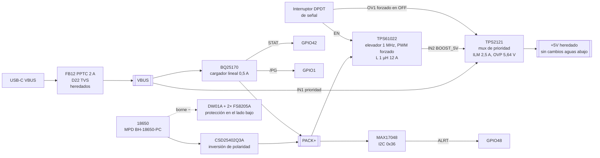

# NEO v2 — Fase 2: propuesta de los bloques nuevos

Documento de trabajo. Los bloques heredados son de Nabu Casa, Inc. (CERN-OHL-P v2);
lo descrito aquí como nuevo es diseño propio de NEO v2.

## 0. Decisiones de entrada y método

Decisiones tuyas tras la fase 1: placa ampliada, altavoz de 8 Ω y 2 W, portapilas en
placa, sin puerto Grove, y la OLED reducida a un conector de pines.

Esta vez la red sí permitía acceder a `ti.com`, `lcsc.com` y `jlcpcb.com`. Todas las
hojas de datos citadas se descargaron y se leyeron; las referencias de sección,
tabla o ecuación son de esas versiones. Los cálculos están en
`hardware/neo-v2/tools/calc_power_v2.py`: cada constante lleva su fuente y la salida
del script es el anexo A de este documento. El stock es una instantánea de la API de
LCSC y del buscador de JLCPCB del 11-10-2026 y cambia a diario.

| Hoja de datos | Revisión leída |
|---|---|
| TPS61022 (elevador) | SLVSDX7D, jul. 2021 |
| TPS61023 / TPS61089 (elevadores alternativos) | SLVSF14B / SLVSD38C |
| BQ25170 (cargador) | SLUSDJ8A, abr. 2021 |
| BQ2407x (cargador alternativo) | SLUS810N, oct. 2021 |
| TPS2121 (multiplexor de alimentación) | SLVSEA3F, ago. 2020 |
| MAX17048 (medidor de carga) | 19-6171 rev. 7 (vía LCSC) |
| DW01A (PUOLOP) y FS8205A (Fuxinsemi) | Hojas del fabricante vía LCSC |
| CSD25402Q3A (P-MOSFET) | Hoja de TI |
| TPA6211A1 | SLOS367E |
| TPS6282x / TPS62065 | SLVSEF9I / hoja de TI |
| ESP32-S3, XU316-1024-QF60B, WS2812B-2020 | Espressif; XMOS vía LCSC; Worldsemi vía LCSC |
| MPD BH-18650-PC (portapilas) | Plano rev. G, 21-08-2024 |
| FAUL0630-1R0MT (bobina) | Especificación del fabricante vía LCSC |

## 1. Correcciones a la fase 1 tras leer las hojas de datos

| Dato de la fase 1 | Valor verificado | Fuente |
|---|---|---|
| WS2812B-2020, corriente | 12 mA por canal, **36 mA en blanco**, < 0,6 mA en reposo. Los 432 mA a blanco total quedan confirmados | Hoja de Worldsemi, *LED Characteristics* |
| ESP32-S3, pico de TX | **340 mA** (802.11b, 1 Mbps, 21 dBm); 88 mA en RX | Hoja de Espressif, tabla de consumo RF |
| XU316, núcleo | **300 mA típicos**, 1 A máximo, muy dependiente de la aplicación | Hoja del XU316, §14.6 |
| TPA6211A1, ganancia | Rf interna = **40 kΩ** (38–42 kΩ) → 40 k/15 k = **2,67 V/V (8,5 dB)** | SLOS367E, 7.5 |
| TPA6211A1 con 8 Ω a 5 V | **1,36 W al 1 % de THD+N**. Tu altavoz de 2 W nunca recibirá su potencia nominal: tiene ~4 dB de margen | SLOS367E, 7.6 |
| TPS62827 | Versión de **4 A**, con modo de ahorro (PSM) automático en carga baja y modo 100 % a partir de 2,4 V | SLVSEF9I |
| TPS62065 | `MODE` alto → **PWM fijo a 3 MHz**, entrada mínima 2,9 V | Hoja de TI |
| U13 SGM2594B | Hoja no disponible, **sin stock en JLCPCB**. Se elimina: el TPS2121 cubre su función (ver §4) | — |

**Hallazgo nuevo de fabricación.** Varias piezas heredadas no se pueden montar tal
cual en JLCPCB: el WS2812B-2020 (C965555) tiene stock 0, y el SGM2594B y el SK-22H07
(interruptor de silencio) no tienen referencia disponible. El **XU316 solo tiene 35
unidades** en LCSC. La traducción completa de la BOM es trabajo de la fase 3, pero
recomiendo **reservar ya los XU316 y los TPS61022** (ver §9).

## 2. Requisitos derivados

Con el altavoz de 8 Ω y sin Grove, el pico simultáneo en +5V es **1,40 A**: TX Wi-Fi
del ESP32, XU316 típico, 12 LED en blanco y amplificador a recorte (Ipico 0,58 A). El
desglose está en el anexo A.1. Dimensiono el elevador para **2,0 A** (43 % de margen),
porque el consumo del XU316 depende del firmware y puede llegar a 1 A.

| Requisito | Valor de diseño |
|---|---|
| Carril +5V | 4,99 V ±2,5 %, 2,0 A continuos en todo el rango de batería |
| Batería | 1 celda Li-ion 18650, 2,7–4,2 V en bornes, sin protección propia (la protección va en placa) |
| Funcionamiento | Con USB, con batería, con ambas, **y con USB sin batería** |
| Carga | Desde el USB-C existente, con NTC, sin depender del firmware |
| Protección | Sobrecarga, sobredescarga, sobrecorriente, cortocircuito, inversión de polaridad |
| Apagado | Interruptor físico. Con el interruptor en OFF, la carga sigue funcionando |
| Medidor | I2C en el bus interno, con alerta a un GPIO |

## 3. Arquitectura propuesta



La idea central es que **el +5V heredado se alimenta exactamente igual que en la
Voice PE cuando hay USB**. El TPS2121 da prioridad a VBUS. Con USB conectado, la
corriente del sistema entra por el mismo punto de la placa que en el original y el
elevador queda sin carga. Solo sin USB, o con una fuente que se hunda por debajo de
4,39 V, el multiplexor pasa en ~5 µs a la salida del elevador. Así, la cadena de audio
heredada trabaja con USB en el mismo entorno eléctrico en que Nabu Casa la validó, y el
riesgo nuevo se concentra en el modo batería, que se puede medir por separado.

Descarté un elevador alimentado siempre desde el power path del cargador
(alternativa B): con USB obliga a que el elevador conmute permanentemente y, sin
batería, no puede entregar el pico de 1,40 A (§5).

## 4. Diseño por bloques

### 4.1 Multiplexor de prioridad: TPS2121RUXR (sustituye a U13)

El TPS2121 integra cuatro funciones: dos interruptores ideales con bloqueo de corriente
inversa, límite de corriente, protección de sobretensión y conmutación rápida. Por eso
reemplaza al SGM2594B (sin stock) sin añadir piezas.

| Función | Cálculo | Valor |
|---|---|---|
| Límite de corriente (eq. 2: ILM = 65,2/RILM^0,861) | RILM = (65,2/2,5)^(1/0,861) = 44,1 kΩ | **RILM = 44,2 kΩ** → 2,0–3,0 A (tabla 7.5); IOCP = 2,4 × ILM ≈ 6 A |
| CP2 (≥ VREF máx. 1,10 V para conmutación rápida) | 4,99 V × 31,6/131,6 | **100 k / 31,6 k** → 1,199 V |
| PR1, prioridad de VBUS (IN1 si PR1 > CP2) | Umbral base 1,199 × 136,5/36,5 = 4,48 V | **100 k / 36,5 k** |
| Histéresis (resistencia de ST a PR1; ST con pull-up de 10 k a +3V3) | Ver anexo A.5 | **2,2 MΩ** → a batería con VBUS < 4,39 V, vuelta a USB con VBUS > 4,54 V |
| OV1, sobretensión de VBUS | 1,06 × 53,2/10 | **43,2 k / 10 k** → 5,64 V (5,37–5,85 V) |
| Apagado por interruptor | 10 k de VBUS a OV1 en OFF | OV1 = 2,2–3,0 V entre 4,0 y 5,5 V de VBUS (≥ 1,10 V y ≤ 5,5 V máx.) |
| Caída en la conmutación (eq. 4) | 5 µs × 1,40 A / 64 µF | 0,11 V → +5V mínimo ≈ 4,3 V |

Dos decisiones que conviene saber defender:

1. **No uso el mismo divisor en PR1 y CP2.** En modo XREF el TPS2121 elige IN1 si
   PR1 > CP2. Con divisores iguales, la decisión sería "VBUS > salida del elevador",
   con ≈5,0 V a cada lado: no habría prioridad real y la conmutación sería errática.
   Lo detecté al hacer el cálculo y lo corregí antes de proponerlo.
2. **La histéresis es necesaria** porque el BQ25170 no tiene VIN-DPM. Con una fuente
   USB débil, la carga más el sistema hunden VBUS, el mux pasa a batería, VBUS se
   recupera y el mux vuelve, oscilando con un periodo que puede caer en banda audible.
   149 mV de histéresis más el desplazamiento del comparador (5–40 mV) cortan ese
   bucle. **Sin verificar en hardware:** queda en la lista de pruebas de arranque.

El modo lento (tSW = 100 µs, CP2 < VREF) haría caer +5V hasta ~2,1 V; por eso CP2 se
fija por encima de 1,10 V.

### 4.2 Elevador: TPS61022RWUT

| Parámetro | Cálculo (SLVSDX7D) | Valor |
|---|---|---|
| Tensión de salida (eq. 4) | R1 = (5,0/0,6 − 1) × 100 k = 733 k | **R1 = 732 kΩ, R2 = 100 kΩ** → 4,992 V |
| Modo | `MODE` alto = PWM forzado (7.4) | **PWM forzado**. En PFM entraría en ráfagas por debajo de ~0,6 A de salida, y la carga de reposo (~0,2 A) cae ahí: ráfagas a frecuencias audibles |
| Bobina | IL(pico) a 2,7 V y 2,0 A = 5,26 A (eqs. 5–7, L −20 %) | **FAUL0630-1R0MT**, 1,0 µH ±20 %, Isat 12 A, Irms 10,5 A, DCR 7,4 mΩ, moldeada y apantallada |
| Margen de límite | Valle 3,44 A frente a 6,5 A mín. de ILIM | IOUT máx. por límite = 3,41 A a 2,7 V |
| Cout (eq. 8) | 2,0 A × 0,54 / (1 MHz × 50 mV) = 21,6 µF ef. | **3 × 22 µF 0805 10 V X5R** (~30 µF ef.) |
| Cin | — | 10 µF + 100 nF junto a VIN |
| Habilitación | EN > 1,2 V; < 0,4 V apaga (7.5) | Desde el interruptor. En apagado, **desconexión real** entre entrada y salida (7.3.2) |

Por qué el TPS61022: ILIM mínimo de 6,5 A, frente a una IL(pico) de 5,26 A; 1 MHz,
fuera de la banda de audio con dos décadas de margen; PWM forzado seleccionable; y
desconexión real en apagado, que evita que el elevador apagado deje ~VBAT − 0,7 V en
IN2. Inconveniente real: **solo hay 208 + 5 unidades en LCSC**.

### 4.3 Cargador: BQ25170DSGR

| Parámetro | Cálculo (SLUSDJ8A) | Valor |
|---|---|---|
| Corriente de carga | ICHG = KISET/RISET = 300 AΩ / 604 Ω | **RISET = 604 Ω** → 497 mA (447–546 mA) |
| Tensión de carga | Tabla de VSET | **RVSET = 27 kΩ** → 4,20 V ±0,5 % |
| Temperatura | NTC 10 k B3380 con ITS = 38 µA: 0 °C → 1,073 V (VCOLD 1,04 V); 45 °C → 0,186 V (VHOT 0,188 V) | **NCP18XH103F03RB** junto a la celda |
| Disipación | (5,0 − VBAT) × 0,5 A = 0,5–1,0 W; RθJA 75 °C/W | En el peor caso entra en regulación térmica (125 °C), que reduce la corriente sola |
| Tiempo de carga | 3,0 Ah / 0,5 A × 1,15 | ≈ 6,9 h |
| Estado | STAT y /PG en drenador abierto, 10 k a ESP_3V3 | STAT → GPIO42, /PG → GPIO1 |

Por qué 0,5 A y no los 0,8 A máximos: con 0,5 A, el pico del sistema (1,40 A) más la
carga suman 1,9 A, por debajo de los 2 A de mantenimiento del PPTC heredado (FB12,
MF-NSMF200-2). Además, 0,5 A son 0,17 C para la celda y limitan el calor del cargador
lineal. La resistencia se puede cambiar a 375 Ω para 0,8 A.

### 4.4 Protección de celda e inversión de polaridad

| Elemento | Pieza | Cálculo |
|---|---|---|
| Protector | **DW01A** (PUOLOP, C351410) | Sobrecarga 4,30 ±0,05 V; sobredescarga 2,50 ±0,10 V; sobrecorriente VEDI 150 mV (130–170); cortocircuito 1,36 V |
| Interruptores | **2 × FS8205A en paralelo** (C908265) | Un solo FS8205A dispara a **2,03 A mín.**: menos que los 3,04 A de batería en el peor caso (2,7 V, 1,40 A). Con dos, el disparo mín. es **4,06 A** (típ. 7,1 A) |
| Inversión de polaridad | **CSD25402Q3A** (TI) en el borne +, puerta al borne − de la celda | RDS(on) 13,3 mΩ a −2,5 V → 123 mW a 3,04 A |

La celda puede insertarse al revés en un portapilas, así que la protección eléctrica
es obligatoria. El P-MOSFET va antes que todo lo demás, con la puerta al borne −. Con la
celda bien puesta, su diodo intrínseco conduce, VGS ≈ −VBAT y el canal se cierra. Con la
celda invertida, VGS es positivo, el MOSFET bloquea y ningún circuito de la placa recibe
tensión inversa, incluido el DW01A, que se alimenta después del MOSFET. El MOSFET
conduce en ambos sentidos cuando está cerrado, así que la carga también funciona. **Sin
verificar en hardware:** prueba de inserción invertida en la lista de arranque.

### 4.5 Medidor: MAX17048G+T10

Se alimenta de PACK+ (2,5–4,5 V) y mide la celda por el mismo pin. La dirección 0x36
no colisiona con 0x18 (AIC3204), 0x3C (OLED) ni 0x42 (XU316). ALRT, en drenador
abierto, va a GPIO48 con 10 k a ESP_3V3. Consume 23 µA activo y 3 µA en hibernación.
Dos matices: según su nota 6, se apaga si SDA y SCL quedan bajos más de 2,5 s, cosa
que ocurre con el interruptor en OFF porque los pull-ups pierden alimentación. Al volver
a encender, estima el estado de carga desde la tensión (*quick-start*), con menos
precisión. Además, la caída en los FET de protección y en el P-MOSFET (~0,1 V a 3 A)
entra en la medida bajo carga.

### 4.6 Interruptor de encendido

Un **DPDT de señal** (MSK-22D18G3, C7507432, 100 mA/12 V; **plano mecánico sin
verificar todavía**) no conduce la corriente de la batería: un polo lleva EN del
elevador a PACK+ (ON) o a GND (OFF); el otro, en OFF, fuerza OV1 del TPS2121 desde
VBUS con 10 k. En OFF todo el sistema queda sin alimentación aunque haya USB, pero el
cargador, que está antes del multiplexor, sigue cargando. El consumo en OFF es de
≈ 5 µA (DW01A 3 µA, FS8205A, MAX17048 apagado, BQ25170 0,35 µA, TPS61022 0,1 µA), muy
por debajo de la autodescarga de la celda.

**Limitación que planteo abiertamente:** no hay corte automático por batería baja. Con
el interruptor en ON y la batería agotada, el firmware debe poner el sistema en su
mínimo consumo (Wi-Fi apagado, XMOS en reset por GPIO4, LED y amplificador apagados) y
el DW01A desconecta a 2,5 V. Un enclavamiento por hardware es posible, pero añade un
modo de fallo (rearranques en bucle) que no quiero introducir sin tu visto bueno. Ver
pregunta 4 en §10.

### 4.7 Conector de la OLED

Tira de 4 pines de 2,54 mm (PZ254V-11-04P, C492403, soldada a mano), en el orden más
común de los módulos SSD1306 de 0,96": **GND, VCC, SCL, SDA**, serigrafiado. VCC sale
de +3V3 a través de una ferrita de la misma familia que las del original (BLM18PG121)
con 10 µF. SDA y SCL llevan 22 Ω en serie (amortiguan el cable) y diodos ESD. El
SSD1306 necesitaría una pantalla real para validarlo, así que no fijo modelo ni
posición, como pediste.

Cálculo del bus (anexo A.6): con el MAX17048 (CB,IN 60 pF), el conector y 10 cm de
cable, el bus llega a ~112 pF. Solo con los 4,7 k de la placa, tr = 446 ns, **por encima
del máximo de 300 ns del modo rápido**. Por eso añado un segundo par de 4,7 k en la
franja nueva: 2,35 k equivalentes dan tr = 223 ns sin OLED, y 149 ns con un módulo que
traiga sus propios 4,7 k. La corriente de sumidero queda en 1,23–1,85 mA, por debajo de
los 3 mA de la especificación. No toco las resistencias heredadas R123/R128.

### 4.8 Puntos de prueba

| Grupo | Ya existen (original) | Nuevos |
|---|---|---|
| Carriles | +5V TP2, +3V3 TP14, ESP_3V3 TP11, VDDIO TP9, 0.9V TP16, VDD TP12, +1V8 TP15, +3.3VA TP22, VDD_MIC TP26, PA_5V TP33, WS2812_5V TP31 | VBUS, PACK+, BAT− (borne de celda), BOOST_5V, OLED_3V3, CELL_P (antes del P-MOSFET) |
| I2C | — | I2C_SDA, I2C_SCL, I2C2_SDA, I2C2_SCL |
| I2S | — | I2S_MCLK, I2S_BCLK, I2S_LRCK, I2S_DIN_SEC (ESP→XMOS), I2S_DIN_ESP (XMOS→DAC), I2S2_BCLK, I2S2_LRCLK, I2S2_DATA |
| Control XMOS | RST_N TP46, BOOT_SEL TP6, X0D31 TP40, RST_DAC TP24, MUTE_ON TP25, AMP_CTL TP23 | XU316_RST (lado ESP, GPIO4), ESP_IO40, ESP_IO41 |
| Bloques nuevos | — | CHG_STAT, CHG_PG, FG_ALRT, BOOST_EN, MUX_ST, SYS_OFF |
| Masa | 10 puntos GND | Un GND junto a cada grupo nuevo |

Los puntos de I2S se ponen **sobre la propia pista**, sin derivación. Un pad de 1 mm
añade ~0,3 pF, despreciable incluso para el MCLK de 24,576 MHz. Donde el layout heredado
no deje sitio, el acceso será el pad de la resistencia serie de 0 Ω que ya existe en
cada línea I2S (R93–R97, R9, R92, R101–R105, R60, R70–R73), documentado en la
serigrafía. Esto se concreta en la fase 4.

## 5. Comparación de combinaciones

| | **A (recomendada)** | B | C |
|---|---|---|---|
| Cargador | BQ25170, lineal 0,5 A (máx. 0,8), entrada hasta 30 V | BQ24074, lineal 1,5 A con power path (DPPM) y VIN-DPM | TP4056, lineal 1 A |
| Elevador | TPS61022, 6,5 A mín., 1 MHz, PWM forzado, desconexión real | TPS61089, 7 A pico ajustable, frecuencia ajustable; PFM en carga baja (la variante TPS610891 con PWM forzado no tiene stock) | TPS61023, valle 2,7 A mín. / 3,7 A típ., SOT-563, solo PFM automático |
| Unión de fuentes | TPS2121, prioridad a USB | Ninguna: +5V siempre desde el elevador, alimentado desde OUT del BQ24074 | Dos Schottky o LM66200 |
| Con USB, el elevador... | Sin carga (fuente original intacta) | **Conmuta siempre**, a 4,4 → 5 V | Sin carga |
| USB sin batería, pico 1,40 A | Sí (VBUS directo, ILM 2,5 A) | **No**: el BQ24074 limita la entrada a 1,5 A → ~1,2 A disponibles en +5V | Sí |
| IOUT máx. del elevador a 2,7–3,0 V | 3,4–3,8 A | > 3 A | **~1,7–1,8 A mín.**: margen insuficiente frente a 1,40 A + tolerancias |
| Ruido en audio | Mínimo con USB; 1 MHz fijo con batería | Peor: conmutación permanente y PFM en carga baja | Peor: PFM en ráfagas en banda audible |
| Protección de entrada | OVP 5,64 V, límite de corriente, 30 V en el cargador | 28 V, VIN-DPM | TP4056: 8 V máx. y sin VIN-DPM |
| Stock LCSC (11-10-2026) | TPS61022 **208**, BQ25170 1.581, TPS2121 28.286 | BQ24074RGTT 243, TPS61089 12.227 | TP4056 47.515, TPS61023 46.870 |
| Coste aprox. de cargador + elevador + unión (1 ud., JLC) | ~5,6 USD | ~4,3 USD | ~0,9 USD |
| Veredicto | **Recomendada** | Descartada por ruido y por el requisito sin batería | Descartada por margen de corriente y calidad del cargador |

Plan B si el TPS61022 se agota: **TPS61088RHLR** (C87357, 2.590 uds.; mismo
fabricante, 10 A, fsw ajustable, VQFN-20 de 3,5 × 4,5 mm). Exige rehacer el elevador
(otra huella, compensación externa) y no tiene desconexión real: en OFF habría que
forzar también OV2.

Común a las tres: protección DW01A + FS8205A, P-MOSFET de polaridad y MAX17048.

## 6. Asignación de pines nuevos

Sin Grove quedan libres GPIO1, GPIO2 y GPIO46. Ningún pin heredado se reasigna.

| GPIO | Uso nuevo | Notas |
|---|---|---|
| 48 | FG_ALRT (MAX17048 ALRT), 10 k a ESP_3V3 | R91 (0 Ω a J6.1) pasa a DNP |
| 42 | CHG_STAT (BQ25170 STAT), 10 k a ESP_3V3 | R135 (0 Ω a J6.6) pasa a DNP |
| 1 | CHG_PG (BQ25170 /PG), 10 k a ESP_3V3 | Antes GROVE_SDA. R84 (a J3.3) pasa a DNP |
| 2 | Libre, a un punto de prueba | Antes GROVE_SCL. R83 (a J3.2) pasa a DNP |
| 46 | Sin conectar | Pin de strapping; sin Grove queda con su pull-down interno |
| 5 / 6 | I2C interno + MAX17048 + conector OLED | Sin cambios en el lado heredado |

Piezas del Grove que desaparecen: J4, U20, Q5, Q7, R40, R67, R117, R118, R137,
R140, R141, R144, R145, FB11, C84, C85, C98, C99, C100, C118, D15, D17, D21.

## 7. Masa y ruido

1. **Una sola masa continua.** In2 sigue siendo el plano de referencia completo y se
   prolonga en la franja nueva. No divido planos: cruzan señales (I2C, GPIO42/48/1),
   y un plano partido bajo una señal aumenta el área del lazo de retorno.
2. **El lazo caliente del elevador queda dentro de la franja:** SW → MOSFET alto →
   Cout → GND → MOSFET bajo, con Cout y PGND junto al encapsulado, vías a In2 bajo los
   condensadores y la bobina moldeada a ras. La corriente de batería (hasta 3 A, casi
   continua gracias a Cin) circula solo entre el portapilas, la protección y el elevador.
3. **Distancias** desde la posición prevista del elevador (≈ 203, 25 mm): micrófono
   U5 61,5 mm, U4 61,8 mm, DAC 70,6 mm, amplificador 61,9 mm, antena 77 mm. Los
   convertidores heredados U10/U12 ya están a 19,6 mm del DAC, así que el nuevo queda
   unas tres veces más lejos que los que la cadena de audio ya tolera.
4. **La isla GNDA no se toca.** Con batería, la corriente del sistema vuelve hacia
   arriba en lugar de hacia el USB. GNDA está unida a GND en dos puntos (R75 abajo, R82 a
   la derecha) y forma un puente por el que puede pasar parte del retorno de los LED
   inferiores (PWM de 2 kHz). Estimación: ≤ 10 mA × ~1 mΩ de la isla = 10 µV entre la
   referencia del DAC y la del amplificador → 27 µV en el altavoz tras 2,67 V/V,
   ~−91 dBV. **Inaudible en el cálculo; sin verificar.** Mitigación prevista: medir en el
   arranque y, si aparece un tono de 2 kHz, retirar R82 para unir en un solo punto
   (R75, junto al jack). Es una opción de montaje y no cambia el layout.
5. **Filtrado de BOOST_5V:** con USB no se usa. Con batería, el rizado de ±50 mV a
   1 MHz pasa por la resistencia del TPS2121 (56 mΩ) y los ~64 µF del carril +5V, un
   RC de ~44 kHz → ≈ −27 dB a 1 MHz (±2,5 mV). A la salida de la franja dejo una huella
   1206 de 0 Ω para una ferrita de alta corriente, por si la medida lo pide. No añado
   un LC de segundo orden: sin amortiguación resuena con los cerámicos y podría
   interactuar con el lazo del elevador.
6. **Amplificador:** su PSRR es de −70 dB en 20 Hz–20 kHz. El residuo a 1 MHz queda
   fuera de banda y FB4/FB5 + 10 nF lo filtran antes del altavoz. El DAC se alimenta de
   +3.3VA (buck → FB8), no de +5V.

## 8. Contorno ampliado y colocación preliminar

El borde superior del original tiene un tramo recto de 53,2 mm (y = 46,2, x
176,6–229,8), con muescas cóncavas hasta y = 49,55 y agujeros de fijación Ø2,7 en
(178,7; 54,2) y (235,2; 54,2). El cuerpo superior mide 73,8 mm de ancho.

Propuesta: **franja nueva de 84 × 30 mm** sobre el borde superior (y 16,2–46,2),
centrada en x = 203,2, que es el eje del dial. Rellena las muescas superiores, pero no
toca el contorno lateral ni la muesca de la antena (abajo a la izquierda), que se
conserva exactamente. Contorno total: 84 × 89 mm, con forma de T: la franja sobresale
3,1 mm por cada lado respecto al cuerpo de 78 mm.

- El **portapilas MPD BH-18650-PC** (77,7 × 20,9 × 21,3 mm; pines a 72,90 mm;
  taladros de fijación Ø3,20 a 55,61 mm, según el plano rev. G) va **en la cara
  posterior (B)**, soldado a mano. Así la cara de LED y micrófonos queda plana y el
  peso de la celda (~45 g) descansa sobre el chasis.
- La electrónica nueva va en la cara F de la franja, bajo el cuerpo del portapilas,
  que solo apoya plástico.
- Interruptor y conector OLED en el borde superior de la franja.
- **SW3** (selector USB ESP/XMOS, borde superior del original en x ≈ 176–186) quedaría
  tapado: dejo una ranura en la franja frente a su actuador para que siga accesible.

Todo esto se cierra en la fase 4, con el plano del interruptor verificado.

## 9. BOM de los bloques nuevos

| Ref. prevista | Pieza | LCSC | Stock LCSC 11-10-2026 | Montaje |
|---|---|---|---|---|
| U101 | TPS2121RUXR | C485916 | 28.286 | JLC |
| U102 | TPS61022RWUT | C2071784 | **208** | JLC, **reservar** |
| L101 | FAUL0630-1R0MT 1,0 µH 12 A | C3040349 | 1.265 | JLC |
| U103 | BQ25170DSGR | C5208201 | 1.581 | JLC |
| U104 | MAX17048G+T10 | C2682616 | 24.078 | JLC |
| U105 | DW01A | C351410 | 113.240 | JLC |
| Q101, Q102 | FS8205A | C908265 | 17.960 | JLC |
| Q103 | CSD25402Q3A | C111356 | 16.405 | JLC |
| RT101 | NCP18XH103F03RB | C13564 | 180.620 | JLC |
| SW101 | MSK-22D18G3 | C7507432 | 6.235 | A mano; plano por verificar |
| J101 | PZ254V-11-04P (OLED) | C492403 | 57.700 | A mano |
| BT101 | MPD BH-18650-PC | — (no está en LCSC) | Digi-Key/Mouser | A mano |
| Heredados pedidos | XU316-1024-QF60B-C24 | C6617472 | **35** | JLC, **reservar** |
| | TLV320AIC3204IRHBR | C24109 | 3.807 | JLC |
| | ESP32-S3R8 | C2913194 | 3.932 | JLC |

Las resistencias y condensadores pasivos se asignan en la fase 3, con preferencia por
piezas "basic" de JLCPCB. Las referencias empiezan en 101 para que se distingan de las
de Nabu Casa.

## 10. Preguntas antes de la fase 3

1. **Portapilas en la cara posterior** (mi recomendación), ¿o en la frontal?
2. **Franja de 84 × 30 mm con forma de T**, ¿o prefieres un rectángulo de 84 mm de
   ancho en toda la altura? El rectángulo rellenaría los laterales, pero no la muesca de
   la antena, que se conserva igual.
3. **Corriente de carga 0,5 A (~7 h)** u 0,8 A (~4,5 h, más calor y 2,2 A de pico total
   desde USB, por encima del PPTC de 2 A).
4. **Corte por batería baja:** solo firmware + DW01A (recomendado para la rev. A), o
   añadir un enclavamiento por hardware que el ESP32 dispare por GPIO2.
5. ¿Reservo/pido ya los XU316 y TPS61022? Yo no puedo comprar; solo te lo señalo.

## 11. Riesgos de esta fase, por gravedad

1. **Disponibilidad:** XU316 (35 uds.) y TPS61022 (213 uds.); piezas heredadas sin
   stock en JLC (WS2812B-2020, SK-22H07) que habrá que sustituir o soldar a mano.
2. **Oscilación del mux con fuentes USB débiles:** mitigada con histéresis, sin
   verificar.
3. **Autonomía modesta:** ~8,7 h en reposo con una celda de 3,0 Ah, porque el XU316 y el
   Wi-Fi están siempre activos (1,1 W). No es un defecto del diseño de alimentación,
   sino de la arquitectura de escucha permanente.
4. **Precisión del MAX17048** bajo carga y tras un OFF (quick-start).
5. **Corriente del puente GNDA** en modo batería: inaudible en el cálculo, por medir.
6. **Terminación de carga con el elevador en reposo:** el elevador en PWM forzado sin
   carga consume del orden de 10–20 mA (estimación por pérdidas, no hay dato en la hoja),
   frente a la corriente de terminación de 50 mA. Debería terminar, pero hay que medirlo.

## Anexo A. Salida de `calc_power_v2.py`

Se regenera con `python3 hardware/neo-v2/tools/calc_power_v2.py`; los valores de las
tablas anteriores salen de ahí.

```text

## 1. Pico de corriente en +5V (altavoz 8 Ω)

Amplificador: Vpico = 4.66 V, Ipico = 0.583 A, I media (seno a 1 % THD) = 0.375 A
Disipación máxima del TPA6211A1: 0.63 W
Ganancia: 40 kΩ / 15 kΩ = 2.67 V/V (8.5 dB) por entrada
- ESP32-S3 TX 802.11b 21 dBm: 340 mA @ 3.3 V → 255 mA en +5V  [ESP32-S3 datasheet, tabla RF: 340 mA pico]
- XU316 núcleo (típ.): 300 mA @ 0.9 V → 66 mA en +5V  [XU316 datasheet §14.6: I(VDD) 300 mA típ.]
- XU316 E/S, flash, USB, 1V8: 40 mA @ 3.3 V → 30 mA en +5V  [estimación]
- AIC3204 + OLED + resto 3V3: 40 mA @ 3.3 V → 30 mA en +5V  [estimación]
- Micrófonos (LDO desde 5 V): 2 mA @ 5.0 V → 2 mA en +5V  [estimación]
- 12 × WS2812B-2020 blanco 100 %: 432 mA @ 5.0 V → 432 mA en +5V  [WS2812B-2020: 36 mA blanco]
- Amplificador (pico): 583 mA @ 5.0 V → 583 mA en +5V  [cálculo anterior]
**Pico simultáneo en +5V: 1.40 A** (Grove eliminado)
Corriente de diseño del elevador: 2.0 A (43 % de margen)

## 2. Elevador TPS61022 (SLVSDX7D)

R1 calculada = 733.3 kΩ → E96 732 kΩ; VOUT = 4.992 V (±2,5 % de VREF)
VIN 2.7 V: D = 0.540, IL(DC) = 4.35 A, ΔIL = 1.82 A pp, IL(pico) = 5.26 A, valle = 3.44 A (< 6,5 A mín.), IOUT máx. por límite = 3.41 A
VIN 3.0 V: D = 0.489, IL(DC) = 3.92 A, ΔIL = 1.83 A pp, IL(pico) = 4.83 A, valle = 3.00 A (< 6,5 A mín.), IOUT máx. por límite = 3.79 A
VIN 3.6 V: D = 0.351, IL(DC) = 3.08 A, ΔIL = 1.58 A pp, IL(pico) = 3.87 A, valle = 2.29 A (< 6,5 A mín.), IOUT máx. por límite = 4.73 A
VIN 4.2 V: D = 0.243, IL(DC) = 2.64 A, ΔIL = 1.27 A pp, IL(pico) = 3.28 A, valle = 2.00 A (< 6,5 A mín.), IOUT máx. por límite = 5.40 A
COUT mínima (eq. 8, 50 mV pp): 21.6 µF efectivos; rango estable 20–1000 µF (7.3)
Elegido: 3 × 22 µF 0805 10 V X5R (~10 µF efectivos c/u a 5 V) + 10 µF entrada

## 3. Corriente de batería y protección DW01A + FS8205A

VBAT 2.7 V: I batería a 1.40 A en +5V = 3.04 A
VBAT 3.0 V: I batería a 1.40 A en +5V = 2.74 A
VBAT 3.6 V: I batería a 1.40 A en +5V = 2.15 A
1 × FS8205A: disparo sobrecorriente mín. = 2.03 A, típ. = 3.57 A  (I batería peor caso 3.04 A)
2 × FS8205A: disparo sobrecorriente mín. = 4.06 A, típ. = 7.14 A  (I batería peor caso 3.04 A)
CSD25402Q3A a 3.04 A, 13,3 mΩ: 123 mW
2×FS8205A en serie-paralelo (2 × 10,5 mΩ): 194 mW

## 4. Cargador BQ25170 (SLUSDJ8A)

RISET = 600 Ω → E96 604 Ω; ICHG = 497 mA (447–546 mA); precarga 20 % = 99 mA; terminación 10 % = 50 mA
RVSET = 27 kΩ → 4,20 V (tabla 8-x)
Disipación a VBUS 5,0 V y VBAT 3.0 V: 1.00 W
Disipación a VBUS 5,0 V y VBAT 3.6 V: 0.70 W
Disipación a VBUS 5,0 V y VBAT 4.0 V: 0.50 W
RθJA = 75,2 °C/W (JEDEC) → a 1,0 W, ΔT = 75 °C: entra en regulación térmica (125 °C)
NTC a 0 °C: 28.22 kΩ → VTS = 1.073 V (umbral VCOLD = 1.04 V)
NTC a 45 °C: 4.90 kΩ → VTS = 0.186 V (umbral VHOT = 0.188 V)
Tiempo de carga aprox. de una celda de 3.0 Ah a 0.5 A: 6.9 h

## 5. Multiplexor de prioridad TPS2121 (SLVSEA3F)

RILM = 44.2 kΩ → 44,2 kΩ (tabla: 2,0–3,0 A); IOCP = 2,4 × ILM = 6.0 A
CP2: 100 k / 31.6 k desde IN2 → 1.199 V (> VREF máx. 1,10 V: conmutación rápida garantizada)
PR1: 100 k / 36.5 k desde VBUS, histéresis 2.2 MΩ desde ST:
  pasa a batería (ST alto, en IN1) con VBUS < 4.39 V
  vuelve a USB (ST bajo, en IN2) con VBUS > 4.54 V (histéresis 149 mV + offset del comparador 5–40 mV)
  con VBUS = 5,0 V: PR1 = 1.337 V > CP2 1.199 V → IN1
OV1: 43.2 k / 10 k → corte por sobretensión en 5.64 V (tolerancia 5.37–5.85 V)
Interruptor en OFF (10 k a VBUS) con VBUS 4.0 V: OV1 = 2.21 V (≥ 1,10 V y ≤ 5,5 V)
Interruptor en OFF (10 k a VBUS) con VBUS 5.0 V: OV1 = 2.76 V (≥ 1,10 V y ≤ 5,5 V)
Interruptor en OFF (10 k a VBUS) con VBUS 5.5 V: OV1 = 3.04 V (≥ 1,10 V y ≤ 5,5 V)
Caída en conmutación (eq. 4) con 5 µs (tFSW típ., CP2 ≥ VREF), 1.40 A, 64 µF efectivos: 0.11 V → +5V mínimo ≈ 4.28 V
Caída en conmutación (eq. 4) con 100 µs (tSW máx., CP2 < VREF: NO usar), 1.40 A, 64 µF efectivos: 2.20 V → +5V mínimo ≈ 2.19 V

## 6. Bus I2C interno con OLED y MAX17048

Capacidad estimada del bus: 112 pF ({'ESP32-S3': 5, 'XU316': 5, 'AIC3204': 10, 'MAX17048 (CB,IN máx.)': 60, 'pistas ~100 mm': 12, 'conector + 10 cm de cable': 10, 'módulo OLED': 10})
4,7 k de placa: tr = 446 ns (máx. 300 ns), I sumidero = 0.62 mA (máx. 3 mA)
4,7 k ‖ 4,7 k nuevas: tr = 223 ns (máx. 300 ns), I sumidero = 1.23 mA (máx. 3 mA)
4,7 k ‖ 4,7 k ‖ 4,7 k módulo OLED: tr = 149 ns (máx. 300 ns), I sumidero = 1.85 mA (máx. 3 mA)

## 7. Autonomía estimada con 18650

Reposo escuchando (Wi-Fi conectado, XMOS activo, LED apagados): 1.00 W en +5V, 1.11 W en batería
Celda 2.5 Ah (9.0 Wh, 90 % útil): 7.3 h en reposo; 5.4 h con 0,4 W medios de audio/LED
Celda 3.0 Ah (10.8 Wh, 90 % útil): 8.7 h en reposo; 6.4 h con 0,4 W medios de audio/LED
Celda 3.5 Ah (12.6 Wh, 90 % útil): 10.2 h en reposo; 7.5 h con 0,4 W medios de audio/LED
Consumo con el interruptor en OFF: ~4.9 µA → 69 años (domina la autodescarga)
```
